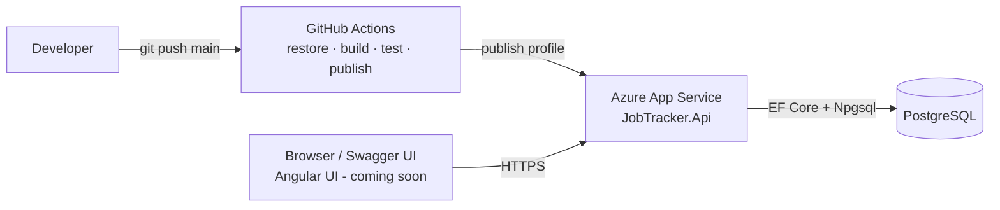

# Job Tracker API

[](https://github.com/juanmunoz00/job-tracker/actions/workflows/deploy.yml)

A cloud-hosted REST API for tracking job applications, from first submission through offer or rejection. It's built with .NET 8 using a layered architecture, deployed to Azure App Service through GitHub Actions, and backed by PostgreSQL.

**Live API (Swagger UI):** https://jobtracker-api-b5efh7c9g8crfwbh.westus3-01.azurewebsites.net/swagger

> Hosted on the Azure App Service free tier, so the first request after a period of inactivity can take 20–30 seconds while the app starts.

---

## Tech stack

| Area | Technology |
|---|---|
| API | ASP.NET Core 8 Web API |
| Data access | Entity Framework Core 8, Npgsql, code-first migrations |
| Database | PostgreSQL (managed) |
| Mapping | AutoMapper |
| API docs | Swagger / OpenAPI (Swashbuckle) |
| Testing | xUnit, Moq, FluentAssertions, EF Core InMemory |
| Hosting | Azure App Service (Linux) |
| CI/CD | GitHub Actions |

## Architecture



### Solution layout

```
JobTracker.sln
├── JobTracker.Api              # Controllers, Program.cs, DI, Swagger, CORS
├── JobTracker.Core             # Domain models, DTOs, repository interfaces (no dependencies)
├── JobTracker.Infrastructure   # ApplicationDbContext, migrations, repository implementations
└── JobTracker.Tests            # Unit tests for controllers, domain and repositories
```

Dependencies only point inward, toward **Core**, which has no reference to EF Core or ASP.NET. Controllers depend on `IApplicationRepository` rather than the database, which keeps them easy to unit test.

## API endpoints

Base route: `/api/applications`

| Method | Route | Description |
|---|---|---|
| `GET` | `/api/applications` | List all applications |
| `GET` | `/api/applications/{id}` | Get one application |
| `POST` | `/api/applications` | Create an application (status starts as `Applied`) |
| `PUT` | `/api/applications/{id}` | Replace an application |
| `PATCH` | `/api/applications/{id}/status` | Update only the status |
| `DELETE` | `/api/applications/{id}` | Delete an application |

**Statuses:** `Applied`, `PhoneScreen`, `Interview`, `TakeHome`, `Offer`, `Rejected`, `Withdrawn`

Example request:

```http
POST /api/applications
Content-Type: application/json

{
  "company": "Contoso",
  "country": "USA",
  "position": "Senior Software Engineer",
  "appliedDate": "2026-10-20"
}
```

## Running locally

**Prerequisites:** .NET 8 SDK, a PostgreSQL database (local or hosted), and the EF Core CLI (`dotnet tool install --global dotnet-ef`).

1. **Clone and restore**
   ```bash
   git clone https://github.com/juanmunoz00/job-tracker.git
   cd job-tracker
   dotnet restore
   ```

2. **Set your connection string with user-secrets.** User-secrets are stored outside the repo, so the password is never committed.
   ```bash
   dotnet user-secrets set "ConnectionStrings:DefaultConnection" \
     "Host=localhost;Port=5432;Database=jobtracker;Username=postgres;Password=<your-password>" \
     --project JobTracker.Api
   ```

3. **Create the schema**
   ```bash
   dotnet ef database update -p JobTracker.Infrastructure -s JobTracker.Api
   ```

4. **Run the API**
   ```bash
   dotnet run --project JobTracker.Api
   ```
   Then open `https://localhost:<port>/swagger`.

5. **Run the tests**
   ```bash
   dotnet test
   ```

## Configuration

| Setting | Where it comes from |
|---|---|
| `ConnectionStrings:DefaultConnection` | Local: user-secrets. Azure: App Service setting `ConnectionStrings__DefaultConnection` |
| `Cors:AllowedOrigins` | `appsettings.json` (defaults to `http://localhost:4200`). Azure: `Cors__AllowedOrigins__0`, `__1`, … |

## CI/CD

Every push to `main` runs [`.github/workflows/deploy.yml`](.github/workflows/deploy.yml):

1. Restore → build (Release) → run tests
2. `dotnet publish` the API
3. Deploy to Azure App Service with a publish profile stored as the `AZURE_WEBAPP_PUBLISH_PROFILE` repository secret

The workflow can also be started manually from the **Actions** tab (`workflow_dispatch`).

## Roadmap

- [x] Layered .NET 8 API with EF Core and PostgreSQL
- [x] Swagger / OpenAPI documentation
- [x] Automated deploy to Azure with GitHub Actions
- [ ] Angular frontend on Azure Static Web Apps
- [ ] Request validation (FluentValidation)
- [ ] Filtering by status and date range

## License

See [LICENSE](LICENSE).
