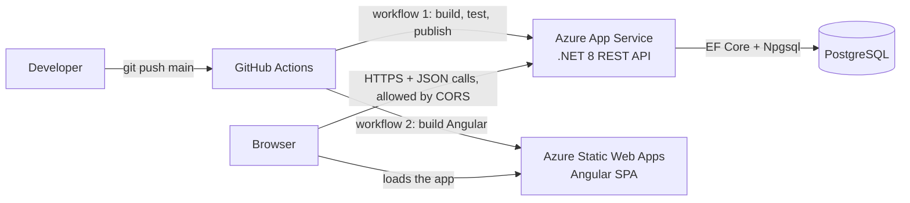

# Job Tracker

[](https://github.com/juanmunoz00/job-tracker/actions/workflows/deploy.yml)

A full-stack, cloud-hosted web application for tracking job applications from first submission to offer or rejection. It has a **.NET 8 REST API** on Azure App Service, an **Angular** single-page application on Azure Static Web Apps, and a **PostgreSQL** database. Both parts deploy automatically through **GitHub Actions** on every push to `main`.

| | Link |
|---|---|
| **Live app (Angular UI)** | `https://victorious-pebble-08457a31e.4.azurestaticapps.net/` *(replace with the URL from your Static Web App's Overview page)* |
| **Live API docs (Swagger UI)** | https://jobtracker-api-b5efh7c9g8crfwbh.westus3-01.azurewebsites.net/swagger |
| **Source code** | https://github.com/juanmunoz00/job-tracker |

> Both parts run on Azure free tiers. The first request after a period of inactivity can take 20–30 seconds while the API starts.

---

## Contents

- [Part 1: What has been built](#part-1-what-has-been-built)
- [Part 2: How to build it, step by step](#part-2-how-to-build-it-step-by-step)
  - [Stage 0: Before you start](#stage-0-before-you-start)
  - [Stage 1: Install the tools and create the accounts](#stage-1-install-the-tools-and-create-the-accounts)
  - [Stage 2: Create the repository and the .NET solution](#stage-2-create-the-repository-and-the-net-solution)
  - [Stage 3: The Core project (domain model)](#stage-3-the-core-project-domain-model)
  - [Stage 4: The Infrastructure project (database access)](#stage-4-the-infrastructure-project-database-access)
  - [Stage 5: The Api project (REST endpoints)](#stage-5-the-api-project-rest-endpoints)
  - [Stage 6: The database and the first migration](#stage-6-the-database-and-the-first-migration)
  - [Stage 7: Run and test the API locally](#stage-7-run-and-test-the-api-locally)
  - [Stage 8: Unit tests](#stage-8-unit-tests)
  - [Stage 9: Commit to GitHub](#stage-9-commit-to-github)
  - [Stage 10: Host the database](#stage-10-host-the-database)
  - [Stage 11: Create the Azure resources for the API](#stage-11-create-the-azure-resources-for-the-api)
  - [Stage 12: Deploy the API with GitHub Actions](#stage-12-deploy-the-api-with-github-actions)
  - [Stage 13: Create the Angular application](#stage-13-create-the-angular-application)
  - [Stage 14: Model, service and data access in Angular](#stage-14-model-service-and-data-access-in-angular)
  - [Stage 15: The application list, status badge and filter](#stage-15-the-application-list-status-badge-and-filter)
  - [Stage 16: The add and edit form](#stage-16-the-add-and-edit-form)
  - [Stage 17: Delete with confirmation](#stage-17-delete-with-confirmation)
  - [Stage 18: Deploy the Angular app to Azure Static Web Apps](#stage-18-deploy-the-angular-app-to-azure-static-web-apps)
  - [Stage 19: Final verification checklist](#stage-19-final-verification-checklist)
  - [Troubleshooting](#troubleshooting)
  - [Cost and security notes](#cost-and-security-notes)
- [Part 3: Definitions](#part-3-definitions)

---

# Part 1: What has been built

## Features

- View every job application in a table, newest first, with company, position, country, date applied, a color-coded status badge, and the time the status last changed.
- Filter the table by status (Applied, Phone screen, Interview, Take-home, Offer, Rejected, Withdrawn).
- Add a new application through a validated form.
- Edit an existing application, including changing its status. The "last updated" time only changes when the status changes.
- Delete an application, with an in-row "Delete? Yes / No" confirmation.
- Browse and call every API endpoint through interactive Swagger documentation.

## Architecture



The browser downloads the Angular application once from Azure Static Web Apps. From then on, the Angular code calls the API directly over [HTTPS](#https). The API reads and writes the PostgreSQL database through [Entity Framework Core](#entity-framework-core). The two Azure services are separate, so the API must explicitly allow the Angular site's address. That rule is called [CORS](#cors).

## Tech stack

| Area | Technology |
|---|---|
| Backend language and framework | C# 12, [.NET 8](#net), [ASP.NET Core](#aspnet-core) Web API |
| Data access | [Entity Framework Core](#entity-framework-core) 8 with [Npgsql](#npgsql), code-first [migrations](#migration) |
| Database | [PostgreSQL](#postgresql) (hosted) |
| Object mapping | [AutoMapper](#automapper) |
| API documentation | [Swagger / OpenAPI](#swagger) (Swashbuckle) |
| Backend tests | [xUnit](#xunit), [Moq](#moq), [FluentAssertions](#fluentassertions), EF Core InMemory |
| Frontend | [Angular](#angular) 22, [TypeScript](#typescript), [signals](#signal), [reactive forms](#reactive-forms), [SCSS](#css-and-scss) |
| Hosting | [Azure App Service](#azure-app-service) (API, Linux, F1 Free), [Azure Static Web Apps](#azure-static-web-apps) (UI, Free) |
| CI/CD | [GitHub Actions](#github-actions), two [workflows](#workflow) |

## Repository layout

```
job-tracker/
├── .github/workflows/
│   ├── deploy.yml                          # API pipeline: build → test → publish → deploy to App Service
│   └── azure-static-web-apps-<name>.yml    # UI pipeline: build Angular → deploy to Static Web Apps
├── JobTracker.sln                          # The .NET solution file
├── JobTracker.Core/                        # Domain model, DTOs, repository interface (no dependencies)
├── JobTracker.Infrastructure/              # DbContext, migrations, repository implementation
├── JobTracker.Api/                         # Controllers, Program.cs, AutoMapper profile, configuration
├── JobTracker.Tests/                       # xUnit tests
└── job-tracker-ui/                         # Angular application
    ├── public/staticwebapp.config.json     # Static Web Apps routing fallback
    └── src/
        ├── environments/                   # API URL for development and production
        └── app/
            ├── models/                     # TypeScript types matching the API's JSON
            ├── services/                   # ApplicationService (all HTTP calls)
            └── components/                 # application-list, application-form, status-badge
```

The .NET code follows a [layered architecture](#layered-architecture). `Core` holds the business types and depends on nothing. `Infrastructure` knows how to talk to the database. `Api` exposes HTTP endpoints. Dependencies only point inward, toward `Core`.

## API endpoints

Base route: `/api/applications`

| Method | Route | What it does | Success response |
|---|---|---|---|
| `GET` | `/api/applications` | List all applications, newest applied date first | `200 OK` + array |
| `GET` | `/api/applications/{id}` | Get one application | `200 OK`, or `404 Not Found` |
| `POST` | `/api/applications` | Create an application. Status starts as `Applied` | `201 Created` |
| `PUT` | `/api/applications/{id}` | Replace an application's editable fields | `200 OK`, `400`, or `404` |
| `PATCH` | `/api/applications/{id}/status` | Change only the status | `200 OK`, or `400` |
| `DELETE` | `/api/applications/{id}` | Delete an application | `204 No Content` |

Valid statuses (case-sensitive): `Applied`, `PhoneScreen`, `Interview`, `TakeHome`, `Offer`, `Rejected`, `Withdrawn`.

See [HTTP methods](#http-methods) and [HTTP status codes](#http-status-codes) in the definitions.

---
# Part 2: How to build it, step by step

This guide builds the whole project from an empty folder. It assumes you know basic C# but nothing else: no prior Angular, Azure, Git or GitHub Actions experience. Every command and every file's complete contents are included.

## Stage 0: Before you start

### How to read this guide

- Words written as [links like this](#definitions-index) jump to **Part 3: Definitions** at the end. Open one whenever a term is new to you.
- Text in `this style` is something you type exactly, or a file or folder name.
- Blocks marked `bash` are commands you run in a **terminal**. On macOS, open the **Terminal** app. On Windows, open **PowerShell**. Run them one line at a time unless the block says otherwise.
- When a step says **"replace the contents"** of a file, select everything in that file (Cmd+A on macOS, Ctrl+A on Windows), delete it, and paste the new contents. Do not add the new code next to the old code. Duplicated code is the most common cause of build errors in this guide.
- After every stage, check the result described under **"Check"** before moving on. Fixing a problem right away is much easier than finding it three stages later.

### What you will need

| Item | Cost | Why |
|---|---|---|
| A computer running macOS, Windows or Linux | — | All tools used here work on all three |
| A [GitHub](#github) account | Free | Stores the code and runs the deployments |
| An [Azure](#azure) account with a card on file | $0 if you follow this guide | Hosts the API and the UI |
| A [PostgreSQL](#postgresql) database you can reach over the internet | Free to a few dollars a month | Stores the data (Stage 10 lists options) |
| About 2–3 working days | — | Most time goes to learning, not typing |

---

## Stage 1: Install the tools and create the accounts

### 1.1 Install Git

[Git](#git) records the history of your code and sends it to GitHub.

- **macOS:** run `git --version` in Terminal. If Git isn't installed, macOS offers to install the Command Line Developer Tools. Accept.
- **Windows:** download and run the installer from https://git-scm.com/download/win, keeping the default options.

**Check:**
```bash
git --version
```
You should see something like `git version 2.4x.x`.

Tell Git who you are (it stamps this on every commit):
```bash
git config --global user.name "Your Name"
git config --global user.email "you@example.com"
```

### 1.2 Install the .NET 8 SDK

The [.NET SDK](#net) contains the compiler and the `dotnet` command used to create, build, test and publish the API.

1. Go to https://dotnet.microsoft.com/download/dotnet/8.0.
2. Under **SDK**, download the installer for your operating system and processor (on Apple Silicon Macs, choose **Arm64**).
3. Run the installer.
4. Close the terminal and open a new one, so it picks up the new command.

**Check:**
```bash
dotnet --list-sdks
```
At least one line must start with `8.`. Newer SDKs (9, 10) can be installed too. This guide pins the project to .NET 8 with `-f net8.0`.

### 1.3 Install Visual Studio Code

[VS Code](#visual-studio-code) is the code editor used in this guide.

1. Download it from https://code.visualstudio.com and install it.
2. Open VS Code, click the **Extensions** icon on the left (four squares), and install:
   - **C# Dev Kit** (by Microsoft)
   - **Angular Language Service** (by Angular)

### 1.4 Install Node.js through nvm

The Angular tools are written in JavaScript and run on [Node.js](#nodejs). [nvm](#nvm) installs and switches between Node versions. Use nvm instead of a direct installer, because different projects often need different Node versions.

**macOS / Linux:**
```bash
curl -o- https://raw.githubusercontent.com/nvm-sh/nvm/v0.40.3/install.sh | bash
```
Close the terminal and open a new one, then:
```bash
nvm install --lts
nvm alias default 'lts/*'
```

**Windows:** install **nvm-windows** from https://github.com/coreybutler/nvm-windows/releases (download `nvm-setup.exe`), then in a new PowerShell window:
```bash
nvm install lts
nvm use lts
```

**Check:**
```bash
node -v
npm -v
```
`node -v` must show **v22 or higher** (this project was built with v24). Angular 22 does not run on Node 20.

> **If `node -v` still shows an old version:** run `which node` (macOS/Linux) or `where node` (Windows). If the path doesn't contain `.nvm` or `nvm`, another Node installation (for example from Anaconda/Conda) is taking priority. Fix that before continuing.

### 1.5 Install the Angular CLI

The [Angular CLI](#angular-cli) is the `ng` command that creates, runs and builds Angular projects.

```bash
npm install -g @angular/cli
```

`-g` means *global*: the `ng` command becomes available in every folder. With nvm you never need `sudo` for this.

**Check:**
```bash
ng version
```
You should see `Angular CLI: 22.x.x`. If it asks *"Would you like to share pseudonymous usage data…"*, answer **N**.

### 1.6 Install the Entity Framework Core tools

The `dotnet-ef` tool creates and applies database [migrations](#migration).

```bash
dotnet tool install --global dotnet-ef --version 8.*
```

**Check:**
```bash
dotnet ef --version
```
You should see `Entity Framework Core .NET Command-line Tools 8.x.x`. If the command isn't found, close and reopen the terminal.

### 1.7 Install PostgreSQL locally (for development)

You need a local [PostgreSQL](#postgresql) server to run the API on your own machine.

- **macOS:** install **Postgres.app** from https://postgresapp.com, open it, and click **Initialize**. The default user is your macOS username with no password. To match this guide, also create a `postgres` user with a password (see the Postgres.app docs) or use your username in the connection string.
- **Windows:** download the installer from https://www.postgresql.org/download/windows/ and run it. When it asks for a password for the `postgres` user, choose one and write it down. Keep port `5432`.

**Check:** the server is running (Postgres.app shows a green "Running" status; on Windows, the **postgresql** service is running in Services).

### 1.8 Create the accounts

1. **GitHub:** sign up at https://github.com/signup.
2. **Azure:** sign up at https://azure.microsoft.com/free.

> **Read this before signing up for Azure.** The Azure free account gives **$200 of credit, one time, valid for 30 days**. It does **not** renew monthly. When the 30 days end, the subscription is disabled and every resource pauses, including free-tier ones. To keep using Azure, you must upgrade to [Pay-As-You-Go](#pay-as-you-go) (Stage 11.1). Everything in this guide stays at $0 on Pay-As-You-Go if you use only the free tiers named here.

---

## Stage 2: Create the repository and the .NET solution

### 2.1 Create the GitHub repository

1. On GitHub, click **+** (top right) → **New repository**.
2. **Repository name:** `job-tracker`.
3. **Public** (so recruiters can see it).
4. Check **Add a README file** and choose a **License** (MIT is common).
5. Click **Create repository**.

### 2.2 Clone it to your computer

[Cloning](#clone) copies the repository to your machine and links the two.

1. On the repository page, click the green **Code** button and copy the **HTTPS** URL.
2. In the terminal, go to the folder where you keep projects, then clone:
```bash
cd ~/dev
git clone https://github.com/<your-username>/job-tracker.git
cd job-tracker
```
Replace `~/dev` with your own projects folder, and `<your-username>` with your GitHub username.

### 2.3 Create the solution and the four projects

A [solution](#solution) groups several projects so they build together.

Run these one at a time, from inside the `job-tracker` folder:

```bash
dotnet new sln -n JobTracker
dotnet new webapi   -n JobTracker.Api            --use-controllers -f net8.0
dotnet new classlib -n JobTracker.Core           -f net8.0
dotnet new classlib -n JobTracker.Infrastructure -f net8.0
dotnet new xunit    -n JobTracker.Tests          -f net8.0
dotnet sln add JobTracker.Api JobTracker.Core JobTracker.Infrastructure JobTracker.Tests
```

What each line does:
- `dotnet new sln` creates `JobTracker.sln`.
- `dotnet new webapi --use-controllers` creates a Web API project that uses [controllers](#controller). Without `--use-controllers`, .NET 8 creates the "minimal API" style instead, which this guide doesn't use.
- `dotnet new classlib` creates a plain class library (no web server).
- `dotnet new xunit` creates a test project using [xUnit](#xunit).
- `-f net8.0` pins each project to .NET 8, even if you have a newer SDK installed.
- `dotnet sln add` registers the four projects in the solution.

### 2.4 Delete the template sample files

The templates include sample code you won't use:

```bash
rm JobTracker.Core/Class1.cs JobTracker.Infrastructure/Class1.cs JobTracker.Tests/UnitTest1.cs
rm JobTracker.Api/WeatherForecast.cs JobTracker.Api/Controllers/WeatherForecastController.cs
```
On Windows PowerShell, use `Remove-Item` instead of `rm`, one file at a time.

### 2.5 Connect the projects to each other

Project references define which project can use which.

```bash
dotnet add JobTracker.Api reference JobTracker.Core JobTracker.Infrastructure
dotnet add JobTracker.Infrastructure reference JobTracker.Core
dotnet add JobTracker.Tests reference JobTracker.Core JobTracker.Infrastructure JobTracker.Api
```

This creates the [layered architecture](#layered-architecture): `Api` → `Infrastructure` → `Core`. `Core` references nothing, so the business types never depend on the database or the web framework.

### 2.6 Add the .gitignore file

A [.gitignore](#gitignore) file lists files Git must never commit: compiled output, editor settings and local secrets.

```bash
dotnet new gitignore
```

**Check:**
```bash
dotnet build
```
You should see `Build succeeded` with `0 Error(s)`.

---

## Stage 3: The Core project (domain model)

`JobTracker.Core` holds the [entity](#entity), the [DTOs](#dto) and the [repository](#repository-pattern) interface. Create the folders `Models`, `DTOs` and `Interfaces` inside `JobTracker.Core`.

### 3.1 The entity: `JobTracker.Core/Models/Application.cs`

The entity describes one job application as stored in the database. The [enum](#enum) lists the allowed statuses.

```csharp
namespace JobTracker.Core.Models;

public class Application
{
    public int Id { get; set; }

    public string Country { get; set; } = string.Empty;
    public string Company { get; set; } = string.Empty;
    public string Position { get; set; } = string.Empty;
    public string? Description { get; set; }
    public string? Link { get; set; }

    public DateOnly AppliedDate { get; set; }

    public ApplicationStatus Status { get; set; } = ApplicationStatus.Applied;
    public DateTime StatusDate { get; set; } = DateTime.UtcNow;

    public string? Notes { get; set; }
    public string? Compensation { get; set; }
}

public enum ApplicationStatus
{
    Applied,
    PhoneScreen,
    Interview,
    TakeHome,
    Offer,
    Rejected,
    Withdrawn
}
```

- `string?` means the value may be `null` (optional field).
- `DateOnly` stores a date with no time (the day you applied).
- `StatusDate` is stored in [UTC](#utc). Storing UTC avoids time-zone confusion.

### 3.2 The DTOs

[DTOs](#dto) are the shapes of data that travel over HTTP. They are separate from the entity so the API never exposes database details directly.

**`JobTracker.Core/DTOs/ApplicationDto.cs`**, returned by GET and sent by PUT:
```csharp
namespace JobTracker.Core.DTOs;

public class ApplicationDto
{
    public int Id { get; set; }
    public string Company { get; set; } = string.Empty;
    public string Country { get; set; } = string.Empty;
    public string Position { get; set; } = string.Empty;
    public DateOnly AppliedDate { get; set; }
    public string Status { get; set; } = string.Empty;
    public DateTime StatusDate { get; set; }
}
```
`Status` is a `string` here (for example `"Interview"`), because readable text is friendlier in [JSON](#json) than the enum's number.

**`JobTracker.Core/DTOs/CreateApplicationDto.cs`**, sent by POST:
```csharp
namespace JobTracker.Core.DTOs;

public class CreateApplicationDto
{
    public string Company { get; set; } = string.Empty;
    public string Country { get; set; } = string.Empty;
    public string Position { get; set; } = string.Empty;
    public DateOnly AppliedDate { get; set; }
}
```
No `Id`, `Status` or `StatusDate`: the server assigns those.

**`JobTracker.Core/DTOs/PatchStatusDto.cs`**, sent by PATCH:
```csharp
namespace JobTracker.Core.DTOs;

public class PatchStatusDto
{
    public string Status { get; set; } = string.Empty;
}
```

### 3.3 The repository interface: `JobTracker.Core/Interfaces/IApplicationRepository.cs`

The [interface](#interface) lists what the data layer can do, without saying how. Controllers depend on this interface, not on the database, which makes them easy to [unit test](#unit-test).

```csharp
using JobTracker.Core.Models;

namespace JobTracker.Core.Interfaces;

public interface IApplicationRepository
{
    Task<IEnumerable<Application>> GetAllAsync();
    Task<Application?> GetByIdAsync(int id);
    Task<Application> CreateAsync(Application application);
    Task<Application> UpdateAsync(Application application);
    Task<Application> PatchStatusAsync(int id, ApplicationStatus status);
    Task DeleteAsync(int id);
}
```

`Task<T>` and the `Async` suffix mean these methods are [asynchronous](#async-and-await): they don't block the server while waiting for the database.

**Check:** `dotnet build` succeeds.

---

## Stage 4: The Infrastructure project (database access)

### 4.1 Add the packages

[NuGet](#nuget) packages are libraries you add to a project.

```bash
dotnet add JobTracker.Infrastructure package Microsoft.EntityFrameworkCore --version 8.0.0
dotnet add JobTracker.Infrastructure package Npgsql.EntityFrameworkCore.PostgreSQL --version 8.0.0
```

- **Microsoft.EntityFrameworkCore** is [EF Core](#entity-framework-core), the [ORM](#orm).
- **Npgsql.EntityFrameworkCore.PostgreSQL** is the [Npgsql](#npgsql) provider that lets EF Core talk to PostgreSQL.

### 4.2 The DbContext: `JobTracker.Infrastructure/Data/ApplicationDbContext.cs`

Create the folder `Data`. The [DbContext](#dbcontext) represents a session with the database. Each `DbSet` is a table.

```csharp
using JobTracker.Core.Models;
using Microsoft.EntityFrameworkCore;

namespace JobTracker.Infrastructure.Data;

public class ApplicationDbContext : DbContext
{
    public ApplicationDbContext(DbContextOptions<ApplicationDbContext> options)
        : base(options)
    {
    }

    public DbSet<Application> Applications => Set<Application>();

    protected override void OnModelCreating(ModelBuilder modelBuilder)
    {
        base.OnModelCreating(modelBuilder);

        modelBuilder.Entity<Application>(entity =>
        {
            entity.HasKey(e => e.Id);

            entity.Property(e => e.Company)
                  .IsRequired()
                  .HasMaxLength(200);

            entity.Property(e => e.Country)
                  .IsRequired()
                  .HasMaxLength(100);

            entity.Property(e => e.Position)
                  .IsRequired()
                  .HasMaxLength(200);

            entity.Property(e => e.Status)
                  .HasConversion<int>();   // store enum as integer

            entity.Property(e => e.StatusDate)
                  .HasDefaultValueSql("NOW()");
        });
    }
}
```

- `OnModelCreating` configures the table: primary key, required columns and maximum lengths.
- `HasConversion<int>()` stores the status as a number (0 = Applied, 1 = PhoneScreen, …).
- `HasDefaultValueSql("NOW()")` makes the database fill in the current time if no value is given.

### 4.3 The repository: `JobTracker.Infrastructure/Repositories/ApplicationRepository.cs`

Create the folder `Repositories`. This class implements the interface from Stage 3.3 using EF Core.

```csharp
using JobTracker.Core.Interfaces;
using JobTracker.Core.Models;
using JobTracker.Infrastructure.Data;
using Microsoft.EntityFrameworkCore;

namespace JobTracker.Infrastructure.Repositories;

public class ApplicationRepository : IApplicationRepository
{
    private readonly ApplicationDbContext _context;

    public ApplicationRepository(ApplicationDbContext context)
    {
        _context = context;
    }

    public async Task<IEnumerable<Application>> GetAllAsync()
        => await _context.Applications
                         .AsNoTracking()
                         .OrderByDescending(a => a.AppliedDate)
                         .ToListAsync();

    public async Task<Application?> GetByIdAsync(int id)
        => await _context.Applications
                         .AsNoTracking()
                         .FirstOrDefaultAsync(a => a.Id == id);

    public async Task<Application> CreateAsync(Application application)
    {
        _context.Applications.Add(application);
        await _context.SaveChangesAsync();
        return application;
    }

    public async Task<Application> UpdateAsync(Application application)
    {
        _context.Applications.Update(application);
        await _context.SaveChangesAsync();
        return application;
    }

    public async Task<Application> PatchStatusAsync(int id, ApplicationStatus status)
    {
        var application = await _context.Applications.FindAsync(id)
            ?? throw new KeyNotFoundException($"Application {id} not found.");

        application.Status = status;
        application.StatusDate = DateTime.UtcNow;
        await _context.SaveChangesAsync();
        return application;
    }

    public async Task DeleteAsync(int id)
    {
        var application = await _context.Applications.FindAsync(id)
            ?? throw new KeyNotFoundException($"Application {id} not found.");

        _context.Applications.Remove(application);
        await _context.SaveChangesAsync();
    }
}
```

- The `DbContext` arrives through the constructor. That's [dependency injection](#dependency-injection).
- `AsNoTracking()` is faster for read-only queries: EF Core doesn't watch the results for changes.
- `SaveChangesAsync()` sends the pending inserts, updates and deletes to the database as [SQL](#sql).
- `?? throw` means "if `FindAsync` returned null, throw an exception".

**Check:** `dotnet build` succeeds.

---

## Stage 5: The Api project (REST endpoints)

### 5.1 Add the packages

```bash
dotnet add JobTracker.Api package AutoMapper --version 12.0.1
dotnet add JobTracker.Api package AutoMapper.Extensions.Microsoft.DependencyInjection --version 12.0.1
dotnet add JobTracker.Api package Microsoft.EntityFrameworkCore.Design --version 8.0.0
dotnet add JobTracker.Api package Swashbuckle.AspNetCore --version 6.6.2
```

- **AutoMapper** and its DI extension: [AutoMapper](#automapper) copies values between entities and DTOs.
- **Microsoft.EntityFrameworkCore.Design** lets `dotnet ef` create migrations using this project's configuration.
- **Swashbuckle.AspNetCore** generates the [Swagger](#swagger) documentation page.

> **Important:** check that `Swashbuckle.AspNetCore` appears in `JobTracker.Api/JobTracker.Api.csproj`. Some template versions don't include it. If `Program.cs` calls `AddSwaggerGen()` but the package is missing, the build fails with error `CS1061 … 'AddSwaggerGen'`.

### 5.2 The mapping profile: `JobTracker.Api/Mappings/ApplicationProfile.cs`

Create the folder `Mappings`. A profile tells AutoMapper how to convert between types.

```csharp
using AutoMapper;
using JobTracker.Core.DTOs;
using JobTracker.Core.Models;

namespace JobTracker.Api.Mappings;

public class ApplicationProfile : Profile
{
    public ApplicationProfile()
    {
        CreateMap<Application, ApplicationDto>()
            .ForMember(dest => dest.Status, opt => opt.MapFrom(src => src.Status.ToString()));

        CreateMap<CreateApplicationDto, Application>()
            .ForMember(dest => dest.Status, opt => opt.MapFrom(_ => ApplicationStatus.Applied))
            .ForMember(dest => dest.StatusDate, opt => opt.MapFrom(_ => DateTime.UtcNow));

        CreateMap<ApplicationDto, Application>()
            .ForMember(dest => dest.Id, opt => opt.Ignore())
            .ForMember(dest => dest.Status, opt => opt.MapFrom(src => Enum.Parse<ApplicationStatus>(src.Status)))
            .ForMember(dest => dest.StatusDate, opt => opt.MapFrom(src => src.StatusDate.ToUniversalTime()));
    }
}
```

The three maps:
1. **Entity → `ApplicationDto`** (for every response): the status enum becomes text.
2. **`CreateApplicationDto` → entity** (for POST): new applications always start as `Applied`, with the current UTC time.
3. **`ApplicationDto` → entity** (for PUT): the text status becomes the enum, the date is forced to UTC (PostgreSQL's `timestamp with time zone` column, through Npgsql, rejects non-UTC values), and `Id` is ignored because the id comes from the URL.

> Every map used in a controller must be declared here. A missing map throws an exception at runtime, which the browser reports as a misleading CORS error (see [Troubleshooting](#troubleshooting)).

### 5.3 The controller: `JobTracker.Api/Controllers/ApplicationsController.cs`

A [controller](#controller) receives HTTP requests and returns responses. Each method below is one [endpoint](#endpoint).

```csharp
using AutoMapper;
using JobTracker.Core.DTOs;
using JobTracker.Core.Interfaces;
using JobTracker.Core.Models;
using Microsoft.AspNetCore.Mvc;

namespace JobTracker.Api.Controllers;

[ApiController]
[Route("api/[controller]")]
public class ApplicationsController : ControllerBase
{
    private readonly IApplicationRepository _repo;
    private readonly IMapper _mapper;

    public ApplicationsController(IApplicationRepository repo, IMapper mapper)
    {
        _repo = repo;
        _mapper = mapper;
    }

    [HttpGet]
    public async Task<IActionResult> GetAll()
    {
        var apps = await _repo.GetAllAsync();
        return Ok(_mapper.Map<IEnumerable<ApplicationDto>>(apps));
    }

    [HttpGet("{id}")]
    public async Task<IActionResult> GetById(int id)
    {
        var app = await _repo.GetByIdAsync(id);
        return app is null ? NotFound() : Ok(_mapper.Map<ApplicationDto>(app));
    }

    [HttpPost]
    public async Task<IActionResult> Create(CreateApplicationDto dto)
    {
        var app = _mapper.Map<Application>(dto);
        var created = await _repo.CreateAsync(app);
        return CreatedAtAction(nameof(GetById), new { id = created.Id },
            _mapper.Map<ApplicationDto>(created));
    }

    [HttpPut("{id}")]
    public async Task<IActionResult> Update(int id, ApplicationDto dto)
    {
        if (!Enum.TryParse<ApplicationStatus>(dto.Status, out _))
            return BadRequest($"Invalid status: {dto.Status}");

        var existing = await _repo.GetByIdAsync(id);
        if (existing is null)
            return NotFound();

        _mapper.Map(dto, existing);
        var updated = await _repo.UpdateAsync(existing);
        return Ok(_mapper.Map<ApplicationDto>(updated));
    }

    [HttpPatch("{id}/status")]
    public async Task<IActionResult> PatchStatus(int id, PatchStatusDto dto)
    {
        if (!Enum.TryParse<ApplicationStatus>(dto.Status, out var status))
            return BadRequest($"Invalid status: {dto.Status}");

        var patched = await _repo.PatchStatusAsync(id, status);
        return Ok(_mapper.Map<ApplicationDto>(patched));
    }

    [HttpDelete("{id}")]
    public async Task<IActionResult> Delete(int id)
    {
        await _repo.DeleteAsync(id);
        return NoContent();
    }
}
```

- `[Route("api/[controller]")]`: `[controller]` is replaced by the class name minus "Controller", giving `/api/applications`.
- `[HttpGet("{id}")]`: `{id}` is a [route parameter](#route-parameter). ASP.NET Core copies it into the `int id` argument through [model binding](#model-binding).
- `Ok(...)`, `NotFound()`, `BadRequest(...)`, `NoContent()` and `CreatedAtAction(...)` produce the [HTTP status codes](#http-status-codes) 200, 404, 400, 204 and 201.
- **`Update` loads the existing record first**, copies the DTO's values onto it with `_mapper.Map(dto, existing)`, then saves. That keeps the fields the DTO doesn't carry (`Description`, `Link`, `Notes`, `Compensation`). Mapping a brand-new entity and saving it would overwrite those columns with `null`.

### 5.4 Program.cs: `JobTracker.Api/Program.cs`

`Program.cs` is the API's entry point. It registers services for [dependency injection](#dependency-injection), then sets up the request [middleware](#middleware) pipeline.

Replace the contents with:

```csharp
using JobTracker.Core.Interfaces;
using JobTracker.Infrastructure.Data;
using JobTracker.Infrastructure.Repositories;
using JobTracker.Api.Mappings;
using Microsoft.EntityFrameworkCore;

var builder = WebApplication.CreateBuilder(args);

builder.Services.AddControllers();
builder.Services.AddAutoMapper(typeof(ApplicationProfile).Assembly);

builder.Services.AddDbContext<ApplicationDbContext>(options =>
    options.UseNpgsql(builder.Configuration.GetConnectionString("DefaultConnection")));

builder.Services.AddScoped<IApplicationRepository, ApplicationRepository>();

builder.Services.AddEndpointsApiExplorer();
builder.Services.AddSwaggerGen();

var allowedOrigins = builder.Configuration.GetSection("Cors:AllowedOrigins").Get<string[]>() ?? [];

builder.Services.AddCors(options =>
    options.AddPolicy("AngularClient", policy =>
        policy.WithOrigins(allowedOrigins)
              .AllowAnyHeader()
              .AllowAnyMethod()));

var app = builder.Build();

app.UseSwagger();
app.UseSwaggerUI();

app.UseHttpsRedirection();
app.UseCors("AngularClient");
app.UseAuthorization();
app.MapControllers();

app.Run();
```

Line by line:
- Everything **before** `builder.Build()` registers services. **Nothing may be added to `builder.Services` after `builder.Build()`.** The service collection is read-only by then, and the app crashes on startup.
- `AddDbContext` + `UseNpgsql(...)` connect EF Core to PostgreSQL, using the [connection string](#connection-string) named `DefaultConnection` from [configuration](#configuration).
- `AddScoped<IApplicationRepository, ApplicationRepository>()`: whenever a class asks for `IApplicationRepository`, give it an `ApplicationRepository`, one instance per HTTP request ("scoped").
- `AddSwaggerGen()` + `UseSwagger()` + `UseSwaggerUI()` serve the docs at `/swagger`. They're enabled in every environment so the live API shows its documentation.
- The [CORS](#cors) policy allows the origins listed in configuration under `Cors:AllowedOrigins`, so new front-end addresses can be added without changing code.
- After `Build()`, the `app.Use...` lines run **in order** for every request.

### 5.5 Configuration files

**Replace the contents of `JobTracker.Api/appsettings.json`:**
```json
{
  "ConnectionStrings": {
    "DefaultConnection": ""
  },
  "Cors": {
    "AllowedOrigins": [ "http://localhost:4200" ]
  },
  "Logging": {
    "LogLevel": {
      "Default": "Information",
      "Microsoft.AspNetCore": "Warning"
    }
  },
  "AllowedHosts": "*"
}
```
- The connection string is **intentionally empty**. Real values come from [user secrets](#user-secrets) locally and from App Service settings in Azure. **Never put a real password in a file that is committed to Git.**
- `http://localhost:4200` is where the Angular development server runs (Stage 13).

**Replace the contents of `JobTracker.Api/appsettings.Development.json`:**
```json
{
  "ConnectionStrings": {
    "DefaultConnection": "Host=localhost;Port=5432;Database=jobtracker;Username=postgres;Password=yourpassword"
  },
  "Logging": {
    "LogLevel": {
      "Default": "Information",
      "Microsoft.AspNetCore": "Warning"
    }
  }
}
```
This placeholder only documents the expected format. The real local value goes into user secrets in the next step, which overrides it.

### 5.6 Store your local connection string in user secrets

[User secrets](#user-secrets) are stored in your user profile folder, outside the repository, so they can never be committed.

```bash
dotnet user-secrets init --project JobTracker.Api
dotnet user-secrets set "ConnectionStrings:DefaultConnection" "Host=localhost;Port=5432;Database=jobtracker;Username=postgres;Password=<your-local-password>" --project JobTracker.Api
```

- `init` adds a `<UserSecretsId>` line to `JobTracker.Api.csproj`. That line is safe to commit.
- Replace `<your-local-password>` with the password you chose in Stage 1.7.
- In zsh (macOS), if the password contains `$` or `!`, use single quotes `'...'` around the connection string instead of double quotes.

**Check:** `dotnet build` succeeds.

---

## Stage 6: The database and the first migration

A [migration](#migration) is a versioned C# script that creates or changes database tables to match your entities.

### 6.1 Create the local database

```bash
psql -U postgres -h localhost -c "CREATE DATABASE jobtracker;"
```
It asks for the `postgres` password. On macOS with Postgres.app, `psql` is available from the app's menu (**Open psql**) if the command isn't found in Terminal.

### 6.2 Create the migration

From the repository root (the folder containing `JobTracker.sln`):

```bash
dotnet ef migrations add InitialCreate -p JobTracker.Infrastructure -s JobTracker.Api
```

- `-p JobTracker.Infrastructure` (*project*): where the migration files are written. That's where the `DbContext` lives.
- `-s JobTracker.Api` (*startup project*): which project's configuration and services to use, including the connection string.

This creates a `Migrations` folder in `JobTracker.Infrastructure` with three files. Commit them. They are the history of your database schema.

### 6.3 Apply it

```bash
dotnet ef database update -p JobTracker.Infrastructure -s JobTracker.Api
```

**Check:** the output ends with `Done.` The `jobtracker` database now has an `Applications` table and an `__EFMigrationsHistory` table.

---

## Stage 7: Run and test the API locally

```bash
dotnet run --project JobTracker.Api
```

The output shows a line like `Now listening on: http://localhost:5296` (the port comes from `JobTracker.Api/Properties/launchSettings.json`).

1. Open `http://localhost:<port>/swagger` in your browser.
2. Expand **POST /api/applications** → **Try it out** → paste:
   ```json
   {
     "company": "Contoso",
     "country": "USA",
     "position": "Senior Software Engineer",
     "appliedDate": "2026-10-20"
   }
   ```
   → **Execute**. Expect **201**, with a response body containing an `id` and `"status": "Applied"`.
3. Run **GET /api/applications**. Expect **200**, with your row in the list.
4. Run **PATCH /api/applications/{id}/status** with body `{ "status": "Interview" }`. Expect **200**.
5. Run **PUT /api/applications/{id}** with the full object from step 3, changing `position`. Expect **200**.
6. Run **DELETE /api/applications/{id}**. Expect **204**.

Press **Ctrl+C** in the terminal to stop the API.

---

## Stage 8: Unit tests

[Unit tests](#unit-test) check the controller's behavior without a real database, using [Moq](#moq) to fake the repository.

### 8.1 Add the test packages

```bash
dotnet add JobTracker.Tests package Moq --version 4.20.72
dotnet add JobTracker.Tests package FluentAssertions --version 8.11.0
dotnet add JobTracker.Tests package AutoMapper --version 12.0.1
dotnet add JobTracker.Tests package Microsoft.EntityFrameworkCore.InMemory --version 8.0.0
```

> **License note:** FluentAssertions version 8 and later requires a paid license for commercial use. It's free for non-commercial and open-source projects like this one. For company work, use version 7.x or check the license terms.

### 8.2 The controller tests: `JobTracker.Tests/Controllers/ApplicationsControllerTests.cs`

Create the folder `Controllers` inside `JobTracker.Tests`.

```csharp
using AutoMapper;
using FluentAssertions;
using JobTracker.Api.Controllers;
using JobTracker.Core.DTOs;
using JobTracker.Core.Interfaces;
using JobTracker.Core.Models;
using JobTracker.Api.Mappings;
using Microsoft.AspNetCore.Mvc;
using Moq;

namespace JobTracker.Tests.Controllers;

public class ApplicationsControllerTests
{
    private readonly Mock<IApplicationRepository> _repoMock;
    private readonly IMapper _mapper;
    private readonly ApplicationsController _controller;

    public ApplicationsControllerTests()
    {
        _repoMock = new Mock<IApplicationRepository>();
        var config = new MapperConfiguration(cfg => cfg.AddProfile<ApplicationProfile>());
        _mapper = config.CreateMapper();
        _controller = new ApplicationsController(_repoMock.Object, _mapper);
    }

    private static Application MakeApp(int id = 1) => new()
    {
        Id = id, Company = "Acme Corp", Country = "US",
        Position = "Senior Software Engineer",
        AppliedDate = new DateOnly(2026, 9, 21),
        Status = ApplicationStatus.Applied,
        StatusDate = DateTime.UtcNow
    };

    [Fact]
    public async Task GetAll_ReturnsOkWithList()
    {
        _repoMock.Setup(r => r.GetAllAsync()).ReturnsAsync([MakeApp()]);
        var result = await _controller.GetAll();
        var ok = result.Should().BeOfType<OkObjectResult>().Subject;
        ok.Value.Should().BeAssignableTo<IEnumerable<ApplicationDto>>();
    }

    [Fact]
    public async Task GetById_ExistingId_ReturnsOk()
    {
        _repoMock.Setup(r => r.GetByIdAsync(1)).ReturnsAsync(MakeApp());
        var result = await _controller.GetById(1);
        result.Should().BeOfType<OkObjectResult>();
    }

    [Fact]
    public async Task GetById_MissingId_ReturnsNotFound()
    {
        _repoMock.Setup(r => r.GetByIdAsync(999)).ReturnsAsync((Application?)null);
        var result = await _controller.GetById(999);
        result.Should().BeOfType<NotFoundResult>();
    }

    [Fact]
    public async Task Create_ValidDto_ReturnsCreatedAtAction()
    {
        var dto = new CreateApplicationDto { Company = "Acme", Country = "US",
            Position = "Engineer", AppliedDate = new DateOnly(2026, 9, 21) };
        _repoMock.Setup(r => r.CreateAsync(It.IsAny<Application>()))
                 .ReturnsAsync(MakeApp());
        var result = await _controller.Create(dto);
        result.Should().BeOfType<CreatedAtActionResult>();
    }

    [Fact]
    public async Task PatchStatus_ValidStatus_ReturnsOk()
    {
        _repoMock.Setup(r => r.PatchStatusAsync(1, ApplicationStatus.Interview))
                 .ReturnsAsync(MakeApp());
        var result = await _controller.PatchStatus(1, new PatchStatusDto { Status = "Interview" });
        result.Should().BeOfType<OkObjectResult>();
    }

    [Fact]
    public async Task PatchStatus_InvalidStatus_ReturnsBadRequest()
    {
        var result = await _controller.PatchStatus(1, new PatchStatusDto { Status = "NotReal" });
        result.Should().BeOfType<BadRequestObjectResult>();
    }

    [Fact]
    public async Task Delete_ExistingId_ReturnsNoContent()
    {
        _repoMock.Setup(r => r.DeleteAsync(1)).Returns(Task.CompletedTask);
        var result = await _controller.Delete(1);
        result.Should().BeOfType<NoContentResult>();
    }
}
```

The test pattern:
- **Arrange:** `_repoMock.Setup(...)` tells the fake repository what to return.
- **Act:** call the controller method.
- **Assert:** `result.Should().BeOfType<...>()` checks the type of response.
- `[Fact]` marks a method as a test.

### 8.3 Run the tests

```bash
dotnet test
```

**Check:** `Passed!` with 0 failed.

---

## Stage 9: Commit to GitHub

A [commit](#commit) is a saved snapshot of your code. [Pushing](#push) sends commits to GitHub.

```bash
git status
```
Read the list. It must **not** contain `bin/`, `obj/` or any file with a real password. If `bin/` or `obj/` appear, your `.gitignore` is missing (go back to Stage 2.6).

```bash
git add .
git commit -m "Add .NET 8 API with EF Core, PostgreSQL, Swagger and tests"
git push origin main
```

**Check:** refresh the repository page on GitHub. Your folders appear there.

---
## Stage 10: Host the database

The deployed API needs a PostgreSQL database it can reach over the internet. Your local database isn't reachable from Azure.

### 10.1 Choose a host

| Option | Cost | Notes |
|---|---|---|
| **Shared hosting that includes PostgreSQL** (this project uses SmarterASP.NET) | Included in the hosting plan | Usually connects through port `6432` via [PgBouncer](#pgbouncer) |
| **Neon** (neon.tech) | Free tier (about 1 GB) | The database sleeps when idle, so the first query after idle is slower |
| **Azure Database for PostgreSQL Flexible Server** | About $15–20/month after the free trial | The most "Azure-native", but the only option here that costs money every month |

This project started on Azure Database for PostgreSQL, then moved to a shared host's PostgreSQL when the Azure free trial ended, to keep the monthly cost at $0. The code didn't change, because PostgreSQL is PostgreSQL wherever it runs. Only the connection string changed.

### 10.2 Create the database on the host

The exact screens differ by host, but the steps are the same:

1. Find **Databases** (or similar) in the host's control panel and choose **PostgreSQL**.
2. Create a database. Many shared hosts add an account prefix to the name and user (for example `db_ab1234_jobtracker` and `ab1234_jobtracker`).
3. Set the database user's password. **Avoid `;`, `'` and `"` in the password**, because they break connection strings.
4. Write down the **host/server name**, **port**, **database name**, **username** and **password**.
5. If the host has a **remote access** or **allowed IP** setting, enable remote access. Both your computer and Azure connect from outside the host's network.

### 10.3 Build the connection string

```
Host=<server>;Port=<port>;Database=<database>;Username=<user>;Password=<password>;Ssl Mode=Prefer;Trust Server Certificate=true
```

- `Ssl Mode=Prefer` encrypts the connection with [SSL/TLS](#ssl-and-tls) when the server supports it. Azure Database for PostgreSQL *requires* encryption, so use `Ssl Mode=Require` there.
- `Trust Server Certificate=true` accepts the server's certificate without checking who issued it. That's common with shared hosts.
- If you see errors mentioning **prepared statements** with port `6432`, add `;No Reset On Close=true;Max Auto Prepare=0` to the end.

**Keep this string private.** Store it in a password manager. Never paste it into a committed file, a public issue or a chat you share.

### 10.4 Create the tables on the hosted database

Apply the same migration from Stage 6, this time pointed at the hosted database with `--connection`. From the repository root:

```bash
dotnet ef database update -p JobTracker.Infrastructure -s JobTracker.Api --connection '<your hosted connection string>'
```

- **Use single quotes** around the connection string. In zsh and bash, an unquoted `;` ends the command, which splits the string apart and produces errors like `command not found: Ssl`.
- **Do not delete the Migrations folder.** `database update` replays your existing migrations against any PostgreSQL database. You'd only regenerate migrations if you switched database engines (for example to SQL Server).

**Check:** the output ends with `Applying migration '..._InitialCreate'.` and `Done.`

| If the error contains | Cause | Fix |
|---|---|---|
| `Build failed` | The code doesn't compile | Run `dotnet build` and fix the errors it lists |
| `Timeout during connection attempt` | The network is blocked | Enable remote access on the host. If the host has an IP allow-list, add your public IP (`curl -4 ifconfig.me`). Try without a VPN |
| `password authentication failed` | Wrong username or password | Recheck both, including any account prefix |
| `database "…" does not exist` | Wrong database name | Copy the exact name from the control panel |

---

## Stage 11: Create the Azure resources for the API

### 11.1 Make sure your subscription is active

1. Sign in at https://portal.azure.com.
2. Search **Subscriptions** in the top bar and open your subscription.
3. If you see **"Your free trial has expired"**, or **Status** is not **Active**, click **Upgrade**:
   - Choose **Pay-As-You-Go**.
   - **Support plan: choose Basic** (free). The other support plans bill every month.
   - Confirm your card and submit. After a few minutes, **Status** shows **Active**.

[Pay-As-You-Go](#pay-as-you-go) charges only for what you use above free amounts. This guide uses only free tiers, so the bill stays at $0. A [free tier](#f1-free-tier) still needs an *active* subscription: an expired trial runs nothing.

### 11.2 Create a budget alert (do this first)

A [budget](#azure-budget) emails you before costs surprise you. Pay-As-You-Go has **no hard spending cap**, so a budget only warns you. It doesn't stop charges.

1. Search **Cost Management** → **Budgets** → **+ Add**.
2. **Scope:** your subscription (or your billing account, which covers all subscriptions).
3. **Name:** `monthly-cap` · **Reset period:** Monthly · **Expiration:** a few years out · **Amount:** `5`.
4. **Next** → add two alert conditions:

   | Type | % of budget | Fires when |
   |---|---|---|
   | Actual | 20 | You've actually been charged $1 |
   | Forecasted | 100 | Azure predicts you'll reach $5 this month |

5. **Alert recipients:** your email address. **Create**.
6. Add `azure-noreply@microsoft.com` to your email's safe senders so alerts don't land in spam.

### 11.3 Create a resource group

A [resource group](#resource-group) is a folder for everything this project owns. Deleting it deletes all of it.

1. Search **Resource groups** → **+ Create**.
2. **Name:** `jobtracker-rg` · **Region:** one near you (this project uses West US 3).
3. **Review + create** → **Create**.

### 11.4 Create the App Service (the API's host)

[Azure App Service](#azure-app-service) runs your API.

1. Search **App Services** → **+ Create** → **Web App**.
2. **Basics** tab:
   - **Resource group:** `jobtracker-rg`
   - **Name:** `jobtracker-api` (must be unique across Azure)
   - **Publish:** Code
   - **Runtime stack:** **.NET 8 (LTS)**
   - **Operating System:** Linux
   - **Region:** the same as the resource group
   - **Pricing plan:** choose **Free F1**. Click **Explore pricing plans** if it isn't selected, and pick F1 under **Dev/Test**.
3. **Review + create** → **Create**, then **Go to resource**.

### 11.5 Note the real address (the default domain)

On the App Service's **Overview**, copy the **Default domain**. Newer App Services get a unique name like:

```
jobtracker-api-b5efh7c9g8crfwbh.westus3-01.azurewebsites.net
```

> **The plain `jobtracker-api.azurewebsites.net` address does not point to your app.** It returns 404. Always use the default domain shown on Overview.

### 11.6 Add the connection string as an app setting

1. In `jobtracker-api` → **Settings** → **Environment variables** → **App settings** tab → **+ Add**.
2. **Name:** `ConnectionStrings__DefaultConnection` (two underscores).
3. **Value:** your hosted connection string from Stage 10.3, without quotes.
4. Leave **Deployment slot setting** unchecked → **Apply** → **Apply** (bottom of page) → **Confirm**.

In .NET [configuration](#configuration), `__` (double underscore) separates sections, so this setting becomes `ConnectionStrings:DefaultConnection`, exactly what `GetConnectionString("DefaultConnection")` reads. Using an App setting instead of the separate "Connection strings" tab avoids a known Linux issue where the value comes back null.

### 11.7 Enable publish credentials

1. In `jobtracker-api` → **Settings** → **Configuration** → **General settings** tab.
2. Confirm **Stack: .NET**, **Version: .NET 8 (LTS)**.
3. Set **SCM Basic Auth Publishing Credentials** to **On** → **Save** → **Continue**.

New App Services turn this off by default. Without it, the publish profile needed in Stage 12 can't be downloaded or doesn't work.

### 11.8 Confirm everything is free

1. Search **All resources** (not "Recently viewed", which only shows pages you've opened).
2. You should see only the App Service and its **App Service plan** (named like `ASP-jobtrackerrg-xxxx`).
3. Open the plan → **Overview** → **Pricing plan** must say **Free (F1)**.

---

## Stage 12: Deploy the API with GitHub Actions

[GitHub Actions](#github-actions) builds, tests and deploys the API automatically every time you push to `main`. That's [CI/CD](#cicd).

### 12.1 Download the publish profile

1. `jobtracker-api` → **Overview** → **Download publish profile**. A `.PublishSettings` file downloads.
2. Open it in a text editor (TextEdit on macOS, Notepad on Windows). It's XML starting with `<publishData>`.
3. Select all and copy.

The [publish profile](#publish-profile) contains deployment credentials, so treat it like a password.

### 12.2 Store it as a GitHub secret

1. On GitHub, open your repository → **Settings** → **Secrets and variables** → **Actions** → **New repository secret**.
2. **Name:** `AZURE_WEBAPP_PUBLISH_PROFILE`.
3. **Secret:** paste the whole XML → **Add secret**.
4. **Delete the downloaded `.PublishSettings` file** and empty the trash.

A [GitHub secret](#github-secret) is encrypted. Workflows can use it, but nobody can read it back, not even you.

### 12.3 Create the workflow: `.github/workflows/deploy.yml`

Create the folders `.github/workflows` at the repository root (note the leading dot), and a file named `deploy.yml` inside:

```yaml
name: Build and Deploy to Azure

on:
  push:
    branches: [ "main" ]
  workflow_dispatch:

env:
  DOTNET_VERSION: '8.0.x'
  AZURE_WEBAPP_NAME: 'jobtracker-api'
  AZURE_WEBAPP_PACKAGE_PATH: './publish'

jobs:
  build-and-deploy:
    runs-on: ubuntu-latest

    steps:
      - name: Checkout
        uses: actions/checkout@v4

      - name: Set up .NET
        uses: actions/setup-dotnet@v4
        with:
          dotnet-version: ${{ env.DOTNET_VERSION }}

      - name: Restore
        run: dotnet restore JobTracker.sln

      - name: Build
        run: dotnet build JobTracker.sln --configuration Release --no-restore

      - name: Test
        run: dotnet test JobTracker.sln --no-build --configuration Release

      - name: Publish
        run: |
          dotnet publish JobTracker.Api/JobTracker.Api.csproj \
            --configuration Release \
            --no-build \
            --output ${{ env.AZURE_WEBAPP_PACKAGE_PATH }}

      - name: Deploy to Azure Web App
        uses: azure/webapps-deploy@v3
        with:
          app-name: ${{ env.AZURE_WEBAPP_NAME }}
          publish-profile: ${{ secrets.AZURE_WEBAPP_PUBLISH_PROFILE }}
          package: ${{ env.AZURE_WEBAPP_PACKAGE_PATH }}
```

How to read it ([YAML](#yaml) uses indentation to show structure, so keep the spaces exactly as shown):
- `on:` lists **only triggers**: every push to `main`, plus `workflow_dispatch`, which adds a **Run workflow** button in the Actions tab. Don't put settings like `app-name` under `on:`; GitHub rejects the file.
- `env:` defines values reused below.
- `runs-on: ubuntu-latest`: GitHub runs the job on a fresh Linux machine (a [runner](#runner)).
- `steps:` run in order: download the code → install .NET 8 → restore packages → build → **run the tests** (a failing test stops the deploy) → publish → deploy using the secret.

### 12.4 Push and watch

```bash
git add .github/workflows/deploy.yml
git commit -m "Add GitHub Actions workflow to deploy the API to Azure"
git push origin main
```

1. On GitHub, open the **Actions** tab.
2. Click the running workflow and watch each step turn green.
3. If a step turns red, click it and read the error (see [Troubleshooting](#troubleshooting)).

### 12.5 Check the live API

Using your **default domain** from Stage 11.5:

- `https://<default-domain>/swagger` shows the Swagger UI.
- `https://<default-domain>/api/applications` returns `[]` (an empty list) or your rows.

The first request after idle can take 20–30 seconds, because F1 apps sleep when unused. If you get a 500 error, open `jobtracker-api` → **Monitoring** → **Log stream**, reload the page, and read the error.

---
## Stage 13: Create the Angular application

The front end is an [Angular](#angular) [single-page application](#spa) written in [TypeScript](#typescript). The browser downloads it once, then it exchanges only [JSON](#json) data with the API.

### 13.1 Create the project

From the **repository root** (the folder containing `JobTracker.sln`):

```bash
ng new job-tracker-ui --style=scss --ssr=false --skip-git
```

- `job-tracker-ui`: the folder and project name. It sits next to the .NET projects in the same repository.
- `--style=scss`: write styles in [SCSS](#css-and-scss).
- `--ssr=false`: no [server-side rendering](#ssr). It isn't needed here and would complicate hosting.
- `--skip-git`: don't create a second Git repository inside the first one.

If it asks more questions:
- *"Which AI tools do you want to configure?"*: choose **None**.
- *"Do you want to create a 'zoneless' application?"*: answer **Yes** (see [zoneless](#zoneless)).

It then downloads the libraries with [npm](#npm), which takes 1–2 minutes and ends with **"Packages installed successfully."**

### 13.2 Run it

```bash
cd job-tracker-ui
ng serve
```

`ng serve` builds the app and starts a development web server on `http://localhost:4200` ([localhost and ports](#localhost-and-port)). Open that address in your browser to see Angular's welcome page.

**Keep `ng serve` running** in this terminal. It rebuilds and reloads the browser every time you save a file. Open a **second terminal tab** (Cmd+T on macOS, or the **+** in Windows Terminal) for all other commands, and run `cd job-tracker-ui` in it. Stop the server with **Ctrl+C**.

### 13.3 Tour of the project

| File / folder | What it is | .NET equivalent |
|---|---|---|
| `package.json` | Lists the libraries and scripts | `.csproj` package references |
| `node_modules/` | Downloaded libraries (huge, never committed) | NuGet cache |
| `angular.json` | Build settings | `.csproj` build settings |
| `tsconfig.json` | TypeScript compiler settings | `<Nullable>`, `<LangVersion>` |
| `public/` | Files copied to the site as-is | `wwwroot/` |
| `src/index.html` | The single HTML page the whole app lives in | Host page |
| `src/main.ts` | Entry point that starts the app | `Program.cs` → `app.Run()` |
| `src/styles.scss` | Styles for the whole app | Site-wide CSS |
| `src/app/app.config.ts` | Registers app-wide services | `builder.Services.Add...` |
| `src/app/app.routes.ts` | URL → page mapping | `[Route]` attributes |
| `src/app/app.ts` / `.html` / `.scss` | The root [component](#component): class, [template](#template), styles | A controller + view |
| `*.spec.ts` | Unit tests ([Vitest](#vitest)) | xUnit test classes |

A **component** is one piece of the screen, made of a TypeScript class (data and logic), an HTML template (what's displayed) and its own styles.

### 13.4 Environment files

[Environment files](#environment-files) hold values that differ between local development and production, here the API's address.

In the second terminal tab, inside `job-tracker-ui`:
```bash
ng generate environments
```
This creates `src/environments/environment.ts` (used by production builds) and `src/environments/environment.development.ts` (used by `ng serve`).

**Replace the contents of `src/environments/environment.ts`:**
```typescript
export const environment = {
  production: true,
  apiUrl: 'https://<your-api-default-domain>/api'
};
```

**Replace the contents of `src/environments/environment.development.ts`:**
```typescript
export const environment = {
  production: false,
  apiUrl: 'https://<your-api-default-domain>/api'
};
```

Replace `<your-api-default-domain>` with the default domain from Stage 11.5 (for example `jobtracker-api-b5efh7c9g8crfwbh.westus3-01.azurewebsites.net`). Both files point at the live API, so you don't need to run the .NET API locally while building the UI. To use a local API instead, set the development file to `http://localhost:<port>/api`.

> Each file must contain **one** `export const environment` block only. A second block gives error `TS2451: Cannot redeclare block-scoped variable 'environment'`.

- `export` makes the constant usable from other files (like `public`).
- `const` means it can't be reassigned (like `readonly`).

---

## Stage 14: Model, service and data access in Angular

### 14.1 The model: `src/app/models/application.ts`

Create the folder `src/app/models` (inside `app`) and the file `application.ts`. These TypeScript types describe the JSON the API sends and receives.

```typescript
export type ApplicationStatus =
  | 'Applied'
  | 'PhoneScreen'
  | 'Interview'
  | 'TakeHome'
  | 'Offer'
  | 'Rejected'
  | 'Withdrawn';

export interface Application {
  id: number;
  company: string;
  country: string;
  position: string;
  appliedDate: string;
  status: ApplicationStatus;
  statusDate: string;
}

export interface CreateApplication {
  company: string;
  country: string;
  position: string;
  appliedDate: string;
}

export const STATUSES: ApplicationStatus[] = [
  'Applied',
  'PhoneScreen',
  'Interview',
  'TakeHome',
  'Offer',
  'Rejected',
  'Withdrawn'
];

export const STATUS_LABELS: Record<ApplicationStatus, string> = {
  Applied: 'Applied',
  PhoneScreen: 'Phone screen',
  Interview: 'Interview',
  TakeHome: 'Take-home',
  Offer: 'Offer',
  Rejected: 'Rejected',
  Withdrawn: 'Withdrawn'
};
```

| TypeScript | Meaning | C# equivalent |
|---|---|---|
| `type ApplicationStatus = 'Applied' \| ...` | A [union type](#union-type): the value must be one of these exact strings | `enum` |
| `interface Application { id: number; ... }` | The shape of an object. It exists only at compile time, so you can't `new` it | A DTO class |
| `id: number` | Name first, type after the colon | `public int Id` |
| `appliedDate: string` | JSON has no date type, so dates arrive as text (`"2026-10-20"`) | — |
| `STATUSES` | The statuses in display order, for dropdowns | `static readonly` array |
| `Record<ApplicationStatus, string>` | An object with exactly one entry per status. Forgetting one is a compile error | `Dictionary<,>` |

Property names are **camelCase** (`appliedDate`) because ASP.NET Core sends JSON in camelCase, even though the C# properties are PascalCase.

### 14.2 Turn on HttpClient: `src/app/app.config.ts`

[HttpClient](#httpclient) is Angular's class for HTTP calls. It must be registered before it can be [injected](#dependency-injection).

**Replace the contents of `src/app/app.config.ts`:**
```typescript
import { ApplicationConfig, provideBrowserGlobalErrorListeners } from '@angular/core';
import { provideRouter, withComponentInputBinding } from '@angular/router';
import { routes } from './app.routes';
import { provideHttpClient, withFetch } from '@angular/common/http';

export const appConfig: ApplicationConfig = {
  providers: [
    provideBrowserGlobalErrorListeners(),
    provideRouter(routes, withComponentInputBinding()),
    provideHttpClient(withFetch())
  ]
};
```

- `providers` is Angular's equivalent of `builder.Services`.
- `provideRouter(routes, withComponentInputBinding())` turns on [routing](#routing) and passes URL parameters (like the `5` in `/edit/5`) into component [inputs](#input) automatically. Stage 16 relies on this.
- `provideHttpClient(withFetch())` registers HttpClient, using the browser's modern `fetch` feature.

### 14.3 The service: `src/app/services/application.service.ts`

Create the folder `src/app/services` (inside `app`, not inside `src` directly) and the file `application.service.ts`. A [service](#service) holds logic shared by many components. This one makes every call to the API, like the repository does on the backend.

```typescript
import { Injectable, inject } from '@angular/core';
import { HttpClient } from '@angular/common/http';
import { Observable } from 'rxjs';
import { environment } from '../../environments/environment';
import { Application, ApplicationStatus, CreateApplication } from '../models/application';

@Injectable({ providedIn: 'root' })
export class ApplicationService {
  private readonly http = inject(HttpClient);
  private readonly baseUrl = `${environment.apiUrl}/applications`;

  getAll(): Observable<Application[]> {
    return this.http.get<Application[]>(this.baseUrl);
  }

  getById(id: number): Observable<Application> {
    return this.http.get<Application>(`${this.baseUrl}/${id}`);
  }

  create(app: CreateApplication): Observable<Application> {
    return this.http.post<Application>(this.baseUrl, app);
  }

  update(id: number, app: Application): Observable<Application> {
    return this.http.put<Application>(`${this.baseUrl}/${id}`, app);
  }

  patchStatus(id: number, status: ApplicationStatus): Observable<Application> {
    return this.http.patch<Application>(`${this.baseUrl}/${id}/status`, { status });
  }

  delete(id: number): Observable<void> {
    return this.http.delete<void>(`${this.baseUrl}/${id}`);
  }
}
```

| TypeScript | Meaning | C# equivalent |
|---|---|---|
| `import { X } from '...'` | Use code from another file or library | `using` |
| `@Injectable({ providedIn: 'root' })` | A [decorator](#decorator): one shared instance for the whole app | `AddSingleton<T>()` |
| `inject(HttpClient)` | Ask [DI](#dependency-injection) for an HttpClient | Constructor injection |
| `` `${environment.apiUrl}/applications` `` | A [template literal](#template-literal) (string interpolation with backticks) | `$"{apiUrl}/applications"` |
| `get<Application[]>(...)` | Generic: "the response is an array of Application" | `GetFromJsonAsync<List<T>>()` |
| `Observable<T>` | A value that arrives later ([Observable](#observable)) | `Task<T>` |
| `{ status }` | Shorthand for `{ status: status }` | `new { Status = status }` |

**An Observable does nothing until someone calls `.subscribe()`.** Calling `getAll()` alone sends no request. The components in the next stages subscribe.

The file is created by hand, not with `ng generate service`, because Angular 22 would name the generated class `Application`, which clashes with the `Application` model.

### 14.4 The root component

The root component becomes a simple layout: a header, then a placeholder where the current page appears.

**Replace the contents of `src/app/app.ts`:**
```typescript
import { Component } from '@angular/core';
import { RouterOutlet } from '@angular/router';

@Component({
  selector: 'app-root',
  imports: [RouterOutlet],
  templateUrl: './app.html',
  styleUrl: './app.scss'
})
export class App {}
```

**Replace the entire contents of `src/app/app.html`** (the generated welcome page is about 240 lines; delete all of it):
```html
<header class="app-header">
  <h1>Job Tracker</h1>
</header>

<main>
  <router-outlet />
</main>
```

- `@Component({...})` is a [decorator](#decorator) that turns the class into a component. `selector: 'app-root'` matches the `<app-root>` tag in `src/index.html`.
- `<router-outlet />` is where the page matching the current URL is displayed (like `@RenderBody()` in a Razor layout).

### 14.5 Global styles: `src/styles.scss`

**Replace the contents of `src/styles.scss`** (this file applies to the whole app, unlike component `.scss` files):

```scss
/* You can add global styles to this file, and also import other style files */
body {
  font-family: system-ui, -apple-system, "Segoe UI", sans-serif;
  color: #1a2233;
  margin: 0;
}

.btn {
  display: inline-block;
  padding: 0.45rem 0.9rem;
  border-radius: 6px;
  border: 1px solid transparent;
  font: inherit;
  font-size: 0.9rem;
  text-decoration: none;
  cursor: pointer;
}

.btn--primary { background: #1f5fbf; color: #fff; }
.btn--primary:hover { background: #194f9f; }
.btn--primary:disabled { opacity: 0.6; cursor: default; }

.btn--ghost { background: transparent; color: #3d4a63; border-color: #c9d1de; }
.btn--ghost:hover { background: #f3f5f9; }
```

`.btn--primary` follows the [BEM](#bem) naming convention: `btn` is the block, `--primary` is a variation.

---

## Stage 15: The application list, status badge and filter

### 15.1 Generate the two components

In the second terminal tab, inside `job-tracker-ui`:

```bash
ng generate component components/application-list
ng generate component components/status-badge
```

Each command creates a folder under `src/app/components/` with four files: `.ts` (class), `.html` (template), `.scss` (styles) and `.spec.ts` (test).

### 15.2 The status badge class: `src/app/components/status-badge/status-badge.ts`

A badge is a small colored "pill" showing a status. The list passes each row's status to it.

**Replace the contents:**
```typescript
import { Component, computed, input } from '@angular/core';
import { ApplicationStatus, STATUS_LABELS } from '../../models/application';

@Component({
  selector: 'app-status-badge',
  templateUrl: './status-badge.html',
  styleUrl: './status-badge.scss'
})
export class StatusBadge {
  readonly status = input.required<ApplicationStatus>();

  protected readonly label = computed(() => STATUS_LABELS[this.status()]);
  protected readonly cssClass = computed(() => `badge badge--${this.status().toLowerCase()}`);
}
```

- `input.required<ApplicationStatus>()` declares an [input](#input), a value the parent component must pass in. Inputs are [signals](#signal), so you read one by calling it: `this.status()`.
- `computed(() => ...)` creates a [computed signal](#computed-signal), recalculated automatically when the signals it reads change. `label` turns `PhoneScreen` into `Phone screen`, and `cssClass` turns it into `badge badge--phonescreen`.

### 15.3 The status badge template: `status-badge.html`

**Replace the contents:**
```html
<span [class]="cssClass()">{{ label() }}</span>
```

- `[class]="cssClass()"` is [property binding](#property-binding): the square brackets mean the value is an expression, not literal text.
- `{{ label() }}` is [interpolation](#interpolation): it inserts the value into the page.

### 15.4 The status badge styles: `status-badge.scss`

**Replace the contents:**
```scss
.badge {
  display: inline-block;
  padding: 0.15rem 0.6rem;
  border-radius: 999px;
  font-size: 0.8rem;
  font-weight: 500;
  white-space: nowrap;
  border: 1px solid transparent;
}

.badge--applied     { background: #eef2f8; color: #3d4a63; border-color: #d6deeb; }
.badge--phonescreen { background: #e6f1fb; color: #0b5cad; border-color: #c4ddf5; }
.badge--interview   { background: #ece8fb; color: #5b3cc4; border-color: #d6cdf5; }
.badge--takehome    { background: #fdf3e1; color: #9a5b00; border-color: #f4dcae; }
.badge--offer       { background: #e3f6ec; color: #11724a; border-color: #bce6cf; }
.badge--rejected    { background: #fdecec; color: #b42318; border-color: #f6caca; }
.badge--withdrawn   { background: #f1f1f1; color: #6b6b6b; border-color: #dcdcdc; }
```

`border-radius: 999px` rounds the box into a pill shape. Colors are [hex codes](#hex-color).

### 15.5 The list class: `src/app/components/application-list/application-list.ts`

This is the final version of the list class. It loads the applications, filters them by status, and handles delete (Stage 17 explains the delete parts).

**Replace the contents:**
```typescript
import { Component, OnInit, computed, inject, signal } from '@angular/core';
import { DatePipe } from '@angular/common';
import { FormsModule } from '@angular/forms';
import { RouterLink } from '@angular/router';
import { ApplicationService } from '../../services/application.service';
import { Application, ApplicationStatus, STATUSES, STATUS_LABELS } from '../../models/application';
import { StatusBadge } from '../status-badge/status-badge';

@Component({
  selector: 'app-application-list',
  imports: [DatePipe, FormsModule, RouterLink, StatusBadge],
  templateUrl: './application-list.html',
  styleUrl: './application-list.scss'
})
export class ApplicationList implements OnInit {
  private readonly applicationService = inject(ApplicationService);

  protected readonly applications = signal<Application[]>([]);
  protected readonly loading = signal(true);
  protected readonly error = signal<string | null>(null);

  protected readonly statuses = STATUSES;
  protected readonly statusLabels = STATUS_LABELS;
  protected readonly statusFilter = signal<ApplicationStatus | 'All'>('All');

  protected readonly filteredApplications = computed(() => {
    const filter = this.statusFilter();
    const apps = this.applications();
    return filter === 'All' ? apps : apps.filter(app => app.status === filter);
  });

  protected readonly filterLabel = computed(() => {
    const filter = this.statusFilter();
    return filter === 'All' ? 'All' : STATUS_LABELS[filter];
  });

  protected readonly confirmingId = signal<number | null>(null);
  protected readonly deletingId = signal<number | null>(null);
  protected readonly deleteError = signal<string | null>(null);

  ngOnInit(): void {
    this.applicationService.getAll().subscribe({
      next: (apps) => {
        this.applications.set(apps);
        this.loading.set(false);
      },
      error: () => {
        this.error.set('Could not load applications. Please try again.');
        this.loading.set(false);
      }
    });
  }

  protected askDelete(id: number): void {
    this.deleteError.set(null);
    this.confirmingId.set(id);
  }

  protected cancelDelete(): void {
    this.confirmingId.set(null);
  }

  protected confirmDelete(id: number): void {
    this.deletingId.set(id);

    this.applicationService.delete(id).subscribe({
      next: () => {
        this.applications.update(apps => apps.filter(app => app.id !== id));
        this.confirmingId.set(null);
        this.deletingId.set(null);
      },
      error: () => {
        this.deleteError.set('Could not delete the application. Please try again.');
        this.deletingId.set(null);
      }
    });
  }
}
```

The key ideas:

- **[Signals](#signal):** `signal<Application[]>([])` creates a box holding a value. Read it with `applications()`, change it with `.set(newValue)`. When a signal changes, Angular redraws only the parts of the screen that read it. This app is [zoneless](#zoneless), so a plain field assigned later would **not** update the screen. Signals are how Angular learns that something changed.
- **`ngOnInit()`** is a [lifecycle hook](#lifecycle-hook): Angular calls it once, right after creating the component. It's the conventional place to load data.
- **`.subscribe({ next, error })`** starts the HTTP request. `next` runs when the data arrives (like code after `await`), and `error` runs on failure (like `catch`). HttpClient Observables complete after one response, so there's nothing to unsubscribe.
- **`filteredApplications`** is a computed signal that reads **two** signals (`statusFilter` and `applications`). Changing either one recalculates it automatically. `apps.filter(...)` is like LINQ's `.Where(...)`.
- **`filterLabel`** uses [type narrowing](#type-narrowing): after the `filter === 'All'` check, TypeScript knows `filter` must be a real status, so `STATUS_LABELS[filter]` is safe.
- **`protected`** members can be used by this component's template, while `private` members can't.
- **`string | null`** is a union type meaning "a string or null" (like `string?`).
- **`imports: [...]`** lists what the template uses: `DatePipe` for dates, `FormsModule` for the filter dropdown, `RouterLink` for links, and `StatusBadge` for badges.

### 15.6 The list template: `application-list.html`

**Replace the contents:**
```html
<section class="list">

  <div class="toolbar">
    <h2>Applications</h2>

    <div class="toolbar-actions">
      <label class="filter">
        Status
        <select [(ngModel)]="statusFilter">
          <option value="All">All</option>
          @for (status of statuses; track status) {
            <option [value]="status">{{ statusLabels[status] }}</option>
          }
        </select>
      </label>

      <a routerLink="/add" class="btn btn--primary">Add application</a>
    </div>
  </div>

  @if (loading()) {
    <p class="muted">Loading applications…</p>
  } @else if (error()) {
    <p class="error">{{ error() }}</p>
  } @else if (applications().length === 0) {
    <p class="muted">No applications yet.</p>
  } @else if (filteredApplications().length === 0) {
    <p class="muted">No applications with status "{{ filterLabel() }}".</p>
  } @else {
    @if (deleteError()) {
      <p class="error">{{ deleteError() }}</p>
    }
    <p class="muted count">
      Showing {{ filteredApplications().length }} of {{ applications().length }}
    </p>

    <table>
      <thead>
        <tr>
          <th>Company</th>
          <th>Position</th>
          <th>Country</th>
          <th>Applied</th>
          <th>Status</th>
          <th>Updated</th>
          <th></th>
        </tr>
      </thead>
      <tbody>
        @for (app of filteredApplications(); track app.id) {
          <tr>
            <td>{{ app.company }}</td>
            <td>{{ app.position }}</td>
            <td>{{ app.country }}</td>
            <td>{{ app.appliedDate | date: 'mediumDate' }}</td>
            <td><app-status-badge [status]="app.status" /></td>
            <td>{{ app.statusDate | date: 'short' }}</td>
            <td class="row-actions">
              @if (confirmingId() === app.id) {
                <span class="confirm-text">Delete?</span>
                <button type="button" class="link link--danger"
                        (click)="confirmDelete(app.id)"
                        [disabled]="deletingId() === app.id">
                  {{ deletingId() === app.id ? 'Deleting…' : 'Yes' }}
                </button>
                <button type="button" class="link" (click)="cancelDelete()">No</button>
              } @else {
                <a [routerLink]="['/edit', app.id]" class="link">Edit</a>
                <button type="button" class="link link--danger" (click)="askDelete(app.id)">Delete</button>
              }
            </td>
          </tr>
        }
      </tbody>
    </table>
  }
</section>
```

| Template syntax | Meaning | Razor equivalent |
|---|---|---|
| `{{ app.company }}` | [Interpolation](#interpolation) | `@app.Company` |
| `@if (...) { } @else if { } @else { }` | Show a block conditionally ([control flow](#control-flow-blocks)) | `@if / else` |
| `@for (app of list; track app.id)` | Repeat a block per item. `track` tells Angular how to identify rows so it redraws only changed ones | `@foreach` |
| `loading()` | Reading a signal: note the parentheses | — |
| `app.appliedDate \| date: 'mediumDate'` | A [pipe](#pipe) formats a value for display (`Oct 20, 2026`) | `.ToString("MMM d, yyyy")` |
| `[(ngModel)]="statusFilter"` | [Two-way binding](#two-way-binding): the dropdown shows the signal's value, and choosing an option updates the signal. Pass the signal itself, **without** parentheses | `@bind` in Blazor |
| `<app-status-badge [status]="app.status" />` | Places the child component and passes this row's status into its input | A partial view with a parameter |
| `routerLink="/add"` | A link to another page inside the SPA, without reloading the page | `asp-action` link |
| `[routerLink]="['/edit', app.id]"` | Builds the URL from parts: `/edit/1`, `/edit/2`, … | — |
| `(click)="askDelete(app.id)"` | [Event binding](#event-binding): run a method on click | `@onclick` |

HTML table tags: `<table>` is the table, `<thead>` the header section, `<tbody>` the body, `<tr>` a row, `<th>` a header cell, and `<td>` a data cell.

### 15.7 The list styles: `application-list.scss`

**Replace the contents:**
```scss
.list {
  max-width: 960px;
  margin: 0 auto;
  padding: 1rem;
}

table {
  width: 100%;
  border-collapse: collapse;
}

th, td {
  text-align: left;
  padding: 0.6rem 0.75rem;
  border-bottom: 1px solid #e2e6ee;
}

th {
  font-size: 0.8rem;
  text-transform: uppercase;
  letter-spacing: 0.04em;
  color: #5a6478;
}

.muted { color: #5a6478; }
.error { color: #b42318; }

.toolbar {
  display: flex;
  align-items: center;
  justify-content: space-between;
  gap: 1rem;
  flex-wrap: wrap;
}

.filter {
  display: flex;
  align-items: center;
  gap: 0.5rem;
  font-size: 0.9rem;
  color: #5a6478;
}

select {
  padding: 0.35rem 0.5rem;
  border: 1px solid #c9d1de;
  border-radius: 6px;
  font: inherit;
  color: #1a2233;
  background: #fff;
}

.count {
  font-size: 0.85rem;
  margin: 0.25rem 0 0.75rem;
}

.toolbar-actions {
  display: flex;
  align-items: center;
  gap: 1rem;
}

.row-actions {
  text-align: right;
  white-space: nowrap;
}

.link {
  color: #1f5fbf;
  text-decoration: none;
  font: inherit;
  font-size: 0.9rem;
  background: none;
  border: 0;
  padding: 0;
  cursor: pointer;
}

.link:hover {
  text-decoration: underline;
}

.link:disabled {
  opacity: 0.6;
  cursor: default;
}

.link--danger {
  color: #b42318;
}

.row-actions > * + * {
  margin-left: 0.75rem;
}

.confirm-text {
  font-size: 0.9rem;
  color: #3d4a63;
}
```

- `rem` is a size relative to the base font (`1rem` is usually 16px).
- `display: flex` ([Flexbox](#flexbox)) lays items out in a row. `justify-content: space-between` pushes the title left and the actions right, and `flex-wrap: wrap` stacks them on narrow screens.
- `margin: 0 auto` centers a block horizontally.
- The `.link` rules remove the default button look so the buttons look like links.
- `.row-actions > * + *` adds space between items in the cell, but not before the first one.
- Component styles affect only that component. Angular rewrites the selectors behind the scenes.

### 15.8 Add the routes: `src/app/app.routes.ts`

[Routes](#routing) map URLs to components. This is the final version, including the form routes from Stage 16. Create the form component (Stage 16.1) before saving this file, or the import will fail.

**Replace the contents:**
```typescript
import { Routes } from '@angular/router';
import { ApplicationList } from './components/application-list/application-list';
import { ApplicationForm } from './components/application-form/application-form';

export const routes: Routes = [
  { path: '', component: ApplicationList },
  { path: 'add', component: ApplicationForm },
  { path: 'edit/:id', component: ApplicationForm },
  { path: '**', redirectTo: '' }
];
```

- `path: ''` is the home page (`/`).
- `'edit/:id'`: `:id` is a [route parameter](#route-parameter), passed into the form's `id` input thanks to `withComponentInputBinding()` (Stage 14.2).
- `'**'` is a wildcard that sends any unknown URL back to the list. It **must stay last**, because routes are checked in order.

---

## Stage 16: The add and edit form

One component handles both pages. At `/add` it shows an empty form and sends a POST. At `/edit/5` it loads application 5, fills in the form, shows a **Status** dropdown, and sends a PUT.

### 16.1 Generate the component

```bash
ng generate component components/application-form
```

### 16.2 The form class: `src/app/components/application-form/application-form.ts`

**Replace the contents:**
```typescript
import { Component, OnInit, computed, inject, input, signal } from '@angular/core';
import { FormBuilder, ReactiveFormsModule, Validators } from '@angular/forms';
import { Router, RouterLink } from '@angular/router';
import { Observable } from 'rxjs';
import { ApplicationService } from '../../services/application.service';
import { Application, ApplicationStatus, STATUSES, STATUS_LABELS } from '../../models/application';

function today(): string {
  const d = new Date();
  d.setMinutes(d.getMinutes() - d.getTimezoneOffset());
  return d.toISOString().slice(0, 10);
}

@Component({
  selector: 'app-application-form',
  imports: [ReactiveFormsModule, RouterLink],
  templateUrl: './application-form.html',
  styleUrl: './application-form.scss'
})
export class ApplicationForm implements OnInit {
  private readonly fb = inject(FormBuilder);
  private readonly applicationService = inject(ApplicationService);
  private readonly router = inject(Router);

  readonly id = input<string>();
  protected readonly isEdit = computed(() => !!this.id());

  protected readonly loading = signal(false);
  protected readonly saving = signal(false);
  protected readonly error = signal<string | null>(null);

  protected readonly statuses = STATUSES;
  protected readonly statusLabels = STATUS_LABELS;

  private original: Application | null = null;

  protected readonly form = this.fb.nonNullable.group({
    company:     ['', [Validators.required, Validators.maxLength(100)]],
    position:    ['', [Validators.required, Validators.maxLength(100)]],
    country:     ['USA', [Validators.required, Validators.maxLength(60)]],
    appliedDate: [today(), Validators.required],
    status:      ['Applied' as ApplicationStatus, Validators.required]
  });

  ngOnInit(): void {
    const id = this.id();
    if (!id) {
      return;   // /add — nothing to load
    }

    this.loading.set(true);
    this.applicationService.getById(Number(id)).subscribe({
      next: (app) => {
        this.original = app;
        this.form.patchValue({
          company: app.company,
          position: app.position,
          country: app.country,
          appliedDate: app.appliedDate,
          status: app.status
        });
        this.loading.set(false);
      },
      error: () => {
        this.error.set('Could not load this application.');
        this.loading.set(false);
      }
    });
  }

  protected submit(): void {
    if (this.form.invalid) {
      this.form.markAllAsTouched();
      return;
    }

    this.saving.set(true);
    this.error.set(null);

    const v = this.form.getRawValue();
    let request$: Observable<unknown>;

    if (this.original) {
      const statusChanged = v.status !== this.original.status;
      request$ = this.applicationService.update(this.original.id, {
        ...this.original,
        company: v.company,
        position: v.position,
        country: v.country,
        appliedDate: v.appliedDate,
        status: v.status,
        statusDate: statusChanged ? new Date().toISOString() : this.original.statusDate
      });
    } else {
      request$ = this.applicationService.create({
        company: v.company,
        position: v.position,
        country: v.country,
        appliedDate: v.appliedDate
      });
    }

    request$.subscribe({
      next: () => this.router.navigate(['/']),
      error: () => {
        this.error.set('Could not save the application. Please try again.');
        this.saving.set(false);
      }
    });
  }
}
```

| Code | Meaning | C# / .NET equivalent |
|---|---|---|
| `today()` | Today's date in **your** time zone. `toISOString()` alone uses [UTC](#utc), which shows "tomorrow" in the evening in the Americas | — |
| `readonly id = input<string>()` | Optional input filled from the URL's `:id`. It's `undefined` on `/add` | `[FromRoute] string? id` |
| `!!this.id()` | Converts to `true`/`false` | `!string.IsNullOrEmpty(id)` |
| `this.fb.nonNullable.group({...})` | Defines the [reactive form](#reactive-forms): `[default value, validation rules]` per field | A view model with `[Required][MaxLength]` |
| `Validators.required`, `Validators.maxLength(100)` | [Validators](#validators), the validation rules | DataAnnotations |
| `nonNullable` | Resetting a field returns it to its default, not `null` | — |
| `Number(id)` | Text `"5"` → number `5`. URL parameters are always text | `int.Parse` |
| `this.form.patchValue({...})` | Fills the form from an object | Setting view model properties |
| `this.form.invalid` / `markAllAsTouched()` | Validation failed / show every error message | `!ModelState.IsValid` |
| `getRawValue()` | The form's values as a plain object | Model binding |
| `{ ...this.original, company: v.company, ... }` | The [spread operator](#spread-operator): copy all properties, then override some | Record `with { ... }` |
| `let request$: Observable<unknown>` | Holds either the PUT or the POST. The `$` suffix is a naming convention for Observables | A `Task` variable |
| `this.router.navigate(['/'])` | Go to the list from code | `RedirectToAction` |

- **Why spread `original`:** the API's PUT expects the full `ApplicationDto`, including `id` and `statusDate`. Spreading keeps fields the form doesn't edit.
- **`statusDate` logic:** it's stamped with the current time only when the status changed, so "Updated" stays meaningful.
- **`saving`** disables Save while the request runs, so a double click can't create duplicates.
- A field is **"touched"** once the user clicks into it and leaves. Errors only show for touched fields, so a fresh form isn't covered in red.

### 16.3 The form template: `application-form.html`

**Replace the contents:**
```html
<section class="form-page">
  <h2>{{ isEdit() ? 'Edit application' : 'Add application' }}</h2>

  @if (loading()) {
    <p class="muted">Loading application…</p>
  } @else {
    <form [formGroup]="form" (ngSubmit)="submit()" novalidate>
      <div class="field">
        <label for="company">Company</label>
        <input id="company" type="text" formControlName="company" />
        @if (form.controls.company.touched && form.controls.company.hasError('required')) {
          <small class="field-error">Company is required.</small>
        }
        @if (form.controls.company.hasError('maxlength')) {
          <small class="field-error">Keep it under 100 characters.</small>
        }
      </div>

      <div class="field">
        <label for="position">Position</label>
        <input id="position" type="text" formControlName="position" />
        @if (form.controls.position.touched && form.controls.position.hasError('required')) {
          <small class="field-error">Position is required.</small>
        }
        @if (form.controls.position.hasError('maxlength')) {
          <small class="field-error">Keep it under 100 characters.</small>
        }
      </div>

      <div class="field">
        <label for="country">Country</label>
        <input id="country" type="text" formControlName="country" />
        @if (form.controls.country.touched && form.controls.country.hasError('required')) {
          <small class="field-error">Country is required.</small>
        }
      </div>

      <div class="field">
        <label for="appliedDate">Applied on</label>
        <input id="appliedDate" type="date" formControlName="appliedDate" />
        @if (form.controls.appliedDate.touched && form.controls.appliedDate.hasError('required')) {
          <small class="field-error">Pick the date you applied.</small>
        }
      </div>

      @if (isEdit()) {
        <div class="field">
          <label for="status">Status</label>
          <select id="status" formControlName="status">
            @for (status of statuses; track status) {
              <option [value]="status">{{ statusLabels[status] }}</option>
            }
          </select>
        </div>
      }

      @if (error()) {
        <p class="error">{{ error() }}</p>
      }

      <div class="actions">
        <a routerLink="/" class="btn btn--ghost">Cancel</a>
        <button type="submit" class="btn btn--primary" [disabled]="saving()">
          {{ saving() ? 'Saving…' : 'Save' }}
        </button>
      </div>
    </form>
  }
</section>
```

| Syntax | Meaning |
|---|---|
| `[formGroup]="form"` | Connects the HTML form to the `form` object in the class |
| `formControlName="company"` | Connects this input to the `company` field, both ways |
| `(ngSubmit)="submit()"` | [Event binding](#event-binding): call `submit()` when the form is submitted (button or Enter key) |
| `novalidate` | Turns off the browser's own validation popups, so only Angular's messages show |
| `hasError('required')` | `true` when that rule fails |
| `type="date"` | The browser's date picker. Its value is text like `"2026-11-02"`, exactly what the API's `DateOnly` expects |
| `<label for="company">` + `id="company"` | Links the label to the input: clicking the label focuses the input, and screen readers announce it |
| `@if (isEdit())` | The Status dropdown only appears when editing. New applications always start as `Applied` |

### 16.4 The form styles: `application-form.scss`

**Replace the contents:**
```scss
.form-page {
  max-width: 520px;
  margin: 0 auto;
  padding: 1rem;
}

form {
  display: flex;
  flex-direction: column;
  gap: 1rem;
}

.field {
  display: flex;
  flex-direction: column;
  gap: 0.3rem;
}

label {
  font-size: 0.85rem;
  font-weight: 500;
  color: #3d4a63;
}

input,
select {
  padding: 0.5rem 0.6rem;
  border: 1px solid #c9d1de;
  border-radius: 6px;
  font: inherit;
  background: #fff;
}

.muted { color: #5a6478; }

input.ng-touched.ng-invalid {
  border-color: #b42318;
}

.field-error,
.error {
  color: #b42318;
  font-size: 0.8rem;
}

.actions {
  display: flex;
  justify-content: flex-end;
  gap: 0.5rem;
  margin-top: 0.5rem;
}
```

Angular automatically adds CSS classes to form fields based on their state: `ng-touched` / `ng-untouched`, `ng-valid` / `ng-invalid`, and `ng-dirty` / `ng-pristine`. The rule `input.ng-touched.ng-invalid` turns the border red on any visited field that fails validation.

**Check:** with `ng serve` running, open `http://localhost:4200`. Click **Add application**, try **Save** with empty fields (red messages appear), then fill it in and save. You land back on the list with the new row. Click **Edit** on a row, change the status and save. The badge changes and **Updated** shows the current time.

---

## Stage 17: Delete with confirmation

The delete feature is already in the files from Stage 15. Here's how it works:

1. **Delete** calls `askDelete(id)`, which stores the row's id in the `confirmingId` signal.
2. The template's `@if (confirmingId() === app.id)` switches **only that row** to "Delete? Yes / No".
3. **No** calls `cancelDelete()`, which sets `confirmingId` back to `null`.
4. **Yes** calls `confirmDelete(id)`. That sets `deletingId` (the button shows "Deleting…" and is disabled), then calls the API.
5. On success, `this.applications.update(apps => apps.filter(app => app.id !== id))` replaces the list with a **new** array without that item. `filteredApplications` recalculates and the row disappears. No page reload is needed.
6. On failure, `deleteError` shows a message above the table. It's separate from `error`, which would hide the whole table.

**Why a new array?** Signals notice a change when they're given a different value. Removing an item from the same array in place (for example with `splice`) leaves it the same object, so the screen wouldn't update. Creating a new array (an [immutable update](#immutable-update)) is the safe pattern.

**Check:** add a throwaway application, click **Delete** → **No** (nothing happens), then **Delete** → **Yes** (the row disappears). Refresh the page: the row is still gone.

Commit your work:
```bash
cd ..
git add job-tracker-ui
git status
git commit -m "Add Angular frontend with list, filter, status badges, add/edit form and delete"
git push origin main
```
In `git status`, confirm that **no** `node_modules/` or `.angular/` paths are listed. Angular's own `job-tracker-ui/.gitignore` excludes them.

---
## Stage 18: Deploy the Angular app to Azure Static Web Apps

[Azure Static Web Apps](#azure-static-web-apps) hosts the built Angular files for free and serves them over HTTPS from a [CDN](#cdn). Like the API, it redeploys automatically on every push.

### 18.1 Add the routing fallback: `job-tracker-ui/public/staticwebapp.config.json`

In a [SPA](#spa), every page is really `index.html`. If someone opens `/edit/5` directly or presses refresh there, Azure looks for a file called `edit/5`, doesn't find it, and returns 404. This file tells Azure to serve `index.html` for any path that isn't a real file, so Angular's router can handle it.

Create the file inside the existing `public` folder:
```json
{
  "navigationFallback": {
    "rewrite": "/index.html",
    "exclude": ["/*.{js,css,ico,png,svg,jpg,webp,woff,woff2,json,txt}"]
  }
}
```

- `rewrite`: serve `index.html` for unknown paths.
- `exclude`: real asset files (scripts, styles, images, fonts) must still return 404 if missing.
- Angular copies everything in `public/` into the build output, so this file lands at the root of the deployed site, where Azure looks for it.

### 18.2 Run a production build locally

Inside `job-tracker-ui`:
```bash
ng build
```

`ng build` creates the optimized production version, using `environment.ts`. It's the equivalent of `dotnet publish -c Release`. When it finishes:
```bash
ls dist/job-tracker-ui/browser
```
You should see `index.html`, several `.js` and `.css` files, and `staticwebapp.config.json`. **Note the path `dist/job-tracker-ui/browser`**, because Azure will ask for it. Don't commit `dist/`; it's already ignored.

Warnings about "budgets" (bundle size limits) are fine. Errors are not.

### 18.3 Commit and push the config file

```bash
cd ..
git add job-tracker-ui/public/staticwebapp.config.json
git commit -m "Add Static Web Apps navigation fallback for Angular routes"
git push origin main
```

### 18.4 Create the Static Web App

1. In the Azure portal, search **Static Web Apps** → **+ Create**.
2. **Basics:**
   - **Resource group:** `jobtracker-rg`
   - **Name:** `jobtracker-ui`
   - **Plan type:** **Free**. Double-check this, because Standard costs money.
   - **Region for Azure Functions API and staging environments:** any listed US region (for example West US 2). The site itself is served globally regardless.
3. **Deployment details:**
   - **Source:** GitHub → **Sign in with GitHub** and authorize Azure.
   - **Organization:** your GitHub username · **Repository:** `job-tracker` · **Branch:** `main`.
4. **Build details:**
   - **Build presets:** Angular
   - **App location:** `./job-tracker-ui` (the folder containing `package.json`; `./` means "from the repository root")
   - **Api location:** leave **empty** (the API is the separate App Service)
   - **Output location:** `dist/job-tracker-ui/browser` (relative to the app location)
5. **Review + create**. Confirm **SKU: Free** → **Create**.

When it finishes, Azure has done three things:
- Created the Static Web App.
- Added a [GitHub secret](#github-secret) named `AZURE_STATIC_WEB_APPS_API_TOKEN_<RANDOM_WORDS>` to your repository (the deploy credential).
- **Committed a new [workflow](#workflow) file** to your repository, `.github/workflows/azure-static-web-apps-<random-words>.yml`, and started its first run.

### 18.5 Get the new workflow file locally

Azure's commit exists on GitHub but not on your computer yet. Pull it now, or your next push will be rejected:

```bash
git pull origin main
```

The generated workflow looks like this. **Don't change it.** The secret name in yours will differ.

```yaml
name: Azure Static Web Apps CI/CD

on:
  push:
    branches:
      - main
  pull_request:
    types: [opened, synchronize, reopened, closed]
    branches:
      - main

jobs:
  build_and_deploy_job:
    if: github.event_name == 'push' || (github.event_name == 'pull_request' && github.event.action != 'closed')
    runs-on: ubuntu-latest
    name: Build and Deploy Job
    steps:
      - uses: actions/checkout@v3
        with:
          submodules: true
          lfs: false
      - name: Build And Deploy
        id: builddeploy
        uses: Azure/static-web-apps-deploy@v1
        with:
          azure_static_web_apps_api_token: ${{ secrets.AZURE_STATIC_WEB_APPS_API_TOKEN_<RANDOM_WORDS> }}
          repo_token: ${{ secrets.GITHUB_TOKEN }} # Used for Github integrations (i.e. PR comments)
          action: "upload"
          app_location: "./job-tracker-ui" # App source code path
          api_location: "" # Api source code path - optional
          output_location: "dist/job-tracker-ui/browser" # Built app content directory - optional

  close_pull_request_job:
    if: github.event_name == 'pull_request' && github.event.action == 'closed'
    runs-on: ubuntu-latest
    name: Close Pull Request Job
    steps:
      - name: Close Pull Request
        id: closepullrequest
        uses: Azure/static-web-apps-deploy@v1
        with:
          azure_static_web_apps_api_token: ${{ secrets.AZURE_STATIC_WEB_APPS_API_TOKEN_<RANDOM_WORDS> }}
          action: "close"
```

- The `Azure/static-web-apps-deploy` action runs `npm install` and `npm run build` inside `app_location`, then uploads `output_location`. The build is done by [Oryx](#oryx), Microsoft's automatic build tool.
- On pull requests, it also creates a temporary preview site, and closes it when the pull request closes.

**Check:** on GitHub → **Actions**, the **Azure Static Web Apps CI/CD** run is green. If the build step fails with a Node.js version error, see [Troubleshooting](#troubleshooting).

### 18.6 Allow the new site in the API's CORS settings

1. Open your Static Web App → **Overview** → copy the **URL** (for example `https://victorious-pebble-08457a31e.3.azurestaticapps.net`).
2. Open the site. The header appears, but the list says **"Could not load applications"**, and the browser console (Cmd+Option+I on macOS, F12 on Windows → **Console**) shows a [CORS](#cors) error. That's expected: the API only allows `http://localhost:4200` so far.
3. In the Azure portal, open **`jobtracker-api`** (the App Service) → **Settings** → **Environment variables** → **App settings** → **+ Add**:
   - **Name:** `Cors__AllowedOrigins__1`
   - **Value:** the Static Web App URL, including `https://` and **without a trailing slash**
4. **Apply** → **Apply** → **Confirm**. The API restarts.

Why `__1`: `appsettings.json` already defines `AllowedOrigins` as a list whose item **0** is `http://localhost:4200`. In .NET [configuration](#configuration), a number after `__` is a list position, so `__1` **adds** a second origin. Using `__0` would **replace** localhost and break local development. No code change or redeploy is needed, because `Program.cs` reads this list at startup.

### 18.7 Test the live site

Wait about 30 seconds, then refresh the Static Web App URL and check each feature:

1. The list loads with colored badges.
2. The status filter works.
3. **Add application** creates a row.
4. **Edit** changes a status, and the badge updates.
5. **Delete** removes a row.
6. On an Edit page, press refresh (Cmd+R / F5). The page reloads correctly instead of returning 404. That's the fallback file from 18.1 at work.

---

## Stage 19: Final verification checklist

| # | Check | Expected |
|---|---|---|
| 1 | `dotnet build` and `dotnet test` locally | Build succeeded, all tests passed |
| 2 | GitHub → Actions → **Build and Deploy to Azure** | Green |
| 3 | GitHub → Actions → **Azure Static Web Apps CI/CD** | Green |
| 4 | `https://<api-default-domain>/swagger` | Swagger UI with all six endpoints |
| 5 | `https://<static-web-app-url>` | The list loads |
| 6 | Add, edit, filter and delete on the live site | All work, with no console errors |
| 7 | Refresh on `/edit/<id>` | No 404 |
| 8 | `git status` on a clean checkout | No `bin/`, `obj/`, `node_modules/`, `.PublishSettings` or passwords committed |
| 9 | Azure → **All resources** | Only the App Service, its plan (**F1**) and the Static Web App (**Free**) |
| 10 | Azure → **Cost Management** → **Cost analysis** | $0.00 (data can lag 8–24 hours) |

---

## Troubleshooting

Every problem below actually happened while building this project.

| Symptom | Cause | Fix |
|---|---|---|
| Publish profile download does nothing; banner says the free trial expired | The Azure trial's 30 days ended; the subscription is disabled | Upgrade to Pay-As-You-Go (Stage 11.1). Free tiers still cost $0 |
| `dotnet ef ...` prints `command not found: Ssl` and `command not found: Trust` | The connection string wasn't quoted, so the shell treated each `;` as the end of a command | Wrap the string in single quotes after `--connection` |
| `Unable to retrieve project metadata` from `dotnet ef` | The connection string was placed after `-p`, which expects a project path | Use `-p JobTracker.Infrastructure -s JobTracker.Api --connection '<string>'` |
| `dotnet ef` says only `Build failed` | The code doesn't compile | Run `dotnet build` to see the real errors |
| `CS1061: 'IServiceCollection' does not contain a definition for 'AddSwaggerGen'` | The Swashbuckle package is missing | `dotnet add JobTracker.Api package Swashbuckle.AspNetCore --version 6.6.2` |
| `Timeout during connection attempt` from Npgsql | Network blocked: firewall, remote access off, server stopped, or VPN | Allow your IP / enable remote access, check the server is running, try without a VPN |
| Workflow green, but the API URL returns 404 | Using `name.azurewebsites.net` instead of the unique default domain | Use the **Default domain** from the App Service Overview |
| API returns 404 or 500 for every route right after a deploy | The app crashes on startup, for example because a service was registered after `builder.Build()` | Register all services before `Build()`. Check **Log stream** |
| A real password shows in `git diff` for `appsettings.Development.json` | A connection string was saved into a committed file | `git checkout -- <file>`, move the value to user secrets, change the password |
| Hundreds of `bin/` and `obj/` files in `git status` | No `.gitignore` | `dotnet new gitignore`, then `git rm -r --cached <project>/bin <project>/obj` for each project |
| GitHub rejects the workflow: `Unexpected value 'app-name'` | Settings were placed under `on:` | `on:` holds only triggers. Settings go in a step's `with:` block |
| `node -v` shows v20 after installing a newer Node | nvm still defaults to the old version, or another Node (e.g. Conda) comes first in the PATH | `nvm alias default 'lts/*'`, open a new terminal, check `which node` |
| `TS2451: Cannot redeclare block-scoped variable 'environment'` | The new code was added next to the generated code instead of replacing it | Leave exactly one `export const environment` block in the file |
| `Could not resolve "./services/application.service"` | The `services` folder was created in `src/` instead of `src/app/` | Move it into `src/app/` |
| `TS2339: Property 'title' does not exist on type 'App'` | The generated `app.html` still uses `{{ title() }}`, which the new `app.ts` removed | Replace `app.html` as in Stage 14.4 |
| `TS2304: Cannot find name 'ApplicationStatus'` | The model file was replaced instead of appended, deleting the type | Restore the full `application.ts` from Stage 14.1 |
| `TS7053: Element implicitly has an 'any' type…` in a template | A template indexed `STATUS_LABELS` with an `any` value | Compute the label in the class with type narrowing (`filterLabel` in Stage 15.5) |
| Saving an edit fails; the console shows a **CORS error** for the PUT only | The **API threw an exception** (missing AutoMapper map). Unhandled exceptions return a 500 without CORS headers, which the browser reports as CORS | **If only one endpoint shows CORS, suspect a server error.** Check **Log stream**. Add the missing map (Stage 5.2) |
| Live site loads but says "Could not load applications"; console shows CORS | The Static Web App's origin isn't allowed by the API | Add `Cors__AllowedOrigins__1` (Stage 18.6), with `https://` and no trailing slash |
| Refreshing `/edit/5` on the live site returns 404 | No navigation fallback | Add `public/staticwebapp.config.json` (Stage 18.1) |
| Static Web Apps build fails with a Node.js version error | Oryx picked an older Node than Angular 22 requires | Add `"engines": { "node": ">=22" }` to `job-tracker-ui/package.json`, or build in the workflow with `actions/setup-node` and set `skip_app_build: true` |

---

## Cost and security notes

**Cost.** At the time of writing, this setup costs **$0/month**:
- App Service plan **F1 (Free)**: 60 CPU minutes per day. If that's exceeded, the app pauses until the next day; it's not billed. Free apps can't use custom domains.
- Static Web Apps **Free**: up to 10 apps per subscription, 2 custom domains per app, and 100 GB of bandwidth per month (it stops serving beyond that instead of billing).
- Charges would come only from changing a tier or creating new paid resources. The budget alerts (Stage 11.2) catch that.

**Security.**
- **There is no authentication.** Anyone with the link can add, edit or delete records. Use demo data only, never your real job search. Adding login is a planned improvement.
- Secrets live in exactly three places: local [user secrets](#user-secrets), Azure App Service settings, and [GitHub secrets](#github-secret). **Never** in committed files.
- If a password is ever shared (in a chat, a screenshot or a commit), change it at the database host, then update the App Service setting and your user secret.
- Delete downloaded `.PublishSettings` files after use.

---
# Part 3: Definitions

## Definitions index

Terms are in alphabetical order. Each entry explains the term in plain language and, where it helps, compares it to something familiar from C# and .NET.

[.NET](#net) · [Angular](#angular) · [Angular CLI](#angular-cli) · [ASP.NET Core](#aspnet-core) · [async and await](#async-and-await) · [AutoMapper](#automapper) · [Azure](#azure) · [Azure App Service](#azure-app-service) · [Azure budget](#azure-budget) · [Azure Static Web Apps](#azure-static-web-apps) · [BEM](#bem) · [CDN](#cdn) · [CI/CD](#cicd) · [Clone](#clone) · [Commit](#commit) · [Component](#component) · [Computed signal](#computed-signal) · [Configuration](#configuration) · [Connection string](#connection-string) · [Control flow blocks](#control-flow-blocks) · [Controller](#controller) · [CORS](#cors) · [CSS and SCSS](#css-and-scss) · [DbContext](#dbcontext) · [Decorator](#decorator) · [Dependency injection](#dependency-injection) · [DTO](#dto) · [Endpoint](#endpoint) · [Entity](#entity) · [Entity Framework Core](#entity-framework-core) · [Enum](#enum) · [Environment files](#environment-files) · [Event binding](#event-binding) · [F1 Free tier](#f1-free-tier) · [Flexbox](#flexbox) · [FluentAssertions](#fluentassertions) · [Git](#git) · [.gitignore](#gitignore) · [GitHub](#github) · [GitHub Actions](#github-actions) · [GitHub secret](#github-secret) · [Hex color](#hex-color) · [HTTP methods](#http-methods) · [HTTP status codes](#http-status-codes) · [HttpClient](#httpclient) · [HTTPS](#https) · [Immutable update](#immutable-update) · [Input](#input) · [Interface](#interface) · [Interpolation](#interpolation) · [JSON](#json) · [Layered architecture](#layered-architecture) · [Lifecycle hook](#lifecycle-hook) · [localhost and port](#localhost-and-port) · [Middleware](#middleware) · [Migration](#migration) · [Model binding](#model-binding) · [Moq](#moq) · [Node.js](#nodejs) · [Npgsql](#npgsql) · [npm](#npm) · [NuGet](#nuget) · [nvm](#nvm) · [Observable](#observable) · [ORM](#orm) · [Oryx](#oryx) · [Pay-As-You-Go](#pay-as-you-go) · [PgBouncer](#pgbouncer) · [Pipe](#pipe) · [PostgreSQL](#postgresql) · [Property binding](#property-binding) · [Publish profile](#publish-profile) · [Push](#push) · [Reactive forms](#reactive-forms) · [Repository pattern](#repository-pattern) · [Resource group](#resource-group) · [Route parameter](#route-parameter) · [Routing](#routing) · [Runner](#runner) · [Service](#service) · [Signal](#signal) · [Solution](#solution) · [SPA](#spa) · [Spread operator](#spread-operator) · [SQL](#sql) · [SSL and TLS](#ssl-and-tls) · [SSR](#ssr) · [Swagger](#swagger) · [Template](#template) · [Template literal](#template-literal) · [Two-way binding](#two-way-binding) · [Type narrowing](#type-narrowing) · [TypeScript](#typescript) · [Union type](#union-type) · [Unit test](#unit-test) · [User secrets](#user-secrets) · [UTC](#utc) · [Validators](#validators) · [Visual Studio Code](#visual-studio-code) · [Vitest](#vitest) · [Workflow](#workflow) · [xUnit](#xunit) · [YAML](#yaml) · [Zoneless](#zoneless)

---

### .NET
Microsoft's free, cross-platform platform for building applications in C#. The **.NET SDK** (Software Development Kit) is what you install to write code: the compiler plus the `dotnet` command (`dotnet new`, `dotnet build`, `dotnet test`, `dotnet run`, `dotnet publish`). The **runtime** is what runs the compiled app; Azure App Service provides it. This project uses .NET 8, a **Long-Term Support (LTS)** release that receives security fixes for three years.

### Angular
A front-end framework from Google for building web applications in TypeScript. An Angular app is made of [components](#component), [services](#service) and [routes](#routing). It runs entirely in the browser.

### Angular CLI
The `ng` command-line tool (**CLI** = Command-Line Interface). `ng new` creates a project, `ng generate` creates components and other files, `ng serve` runs a development server, and `ng build` produces the production files. Roughly the Angular equivalent of the `dotnet` command.

### ASP.NET Core
The part of .NET for building web applications and web APIs. It receives HTTP requests, runs them through [middleware](#middleware), routes them to [controllers](#controller), and sends back responses.

### async and await
C# keywords for **asynchronous** code. A method marked `async` returning `Task<T>` can `await` slow operations (database queries, HTTP calls) without blocking the thread, so the server can handle other requests while waiting. The TypeScript equivalent in this project is the [Observable](#observable).

### AutoMapper
A .NET library that copies values between objects of different types, for example from an [entity](#entity) to a [DTO](#dto). You declare each conversion once in a **profile** (`CreateMap<Source, Destination>()`), then call `_mapper.Map<Destination>(source)`. If a conversion isn't declared, AutoMapper throws an exception at runtime.

### Azure
Microsoft's cloud platform: computers, databases, storage and services you rent by usage instead of owning. You manage it at https://portal.azure.com. Resources live inside a **subscription** (the billing account) and are organized into [resource groups](#resource-group).

### Azure App Service
An Azure service that runs web applications and APIs without you managing a server. You deploy your published code, and Azure provides the operating system, the .NET runtime, HTTPS and a public address. Its computing power comes from an **App Service plan**; this project uses the [F1 Free tier](#f1-free-tier).

### Azure budget
A spending threshold in Azure Cost Management that emails you when actual or forecasted costs reach a percentage of it. It **warns** only. It never stops resources or charges.

### Azure Static Web Apps
An Azure service for hosting static front-end files (HTML, JavaScript, CSS) such as a built Angular app. It connects to a GitHub repository, builds and deploys on every push, serves files over HTTPS from a [CDN](#cdn), and supports custom domains. The Free plan allows up to 10 apps per subscription.

### BEM
**Block Element Modifier**, a CSS class-naming convention. `badge` is a block, and `badge--offer` is a modifier (a variation) of it. It keeps class names predictable and avoids conflicts.

### CDN
**Content Delivery Network**: a group of servers around the world that keep copies of your files, so each visitor downloads them from a nearby server.

### CI/CD
**Continuous Integration / Continuous Deployment**. CI automatically builds and tests the code on every change. CD automatically deploys it when the tests pass. Here, both are done by [GitHub Actions](#github-actions).

### Clone
Copying a [Git](#git) repository from GitHub to your computer with `git clone <url>`. The copy stays linked to GitHub, so you can [push](#push) changes back.

### Commit
A saved snapshot of your code in [Git](#git), with a message describing the change. `git add` chooses which changes go into the next commit, and `git commit -m "message"` saves it locally.

### Component
The basic building block of an Angular app: one piece of the screen. It's a TypeScript class marked with `@Component`, plus a [template](#template) (HTML) and styles. Its `selector` (for example `app-status-badge`) becomes an HTML tag other templates can use.

### Computed signal
A [signal](#signal) whose value is calculated from other signals with `computed(() => ...)`. Angular recalculates it automatically whenever any signal it reads changes, and caches the result otherwise. Similar to a getter-only C# property that updates itself.

### Configuration
How .NET apps read settings. Values come from several sources, in order, and later sources override earlier ones: `appsettings.json` → `appsettings.{Environment}.json` → [user secrets](#user-secrets) (in Development) → environment variables (such as Azure App Service settings). Sections are separated by `:` in code (`ConnectionStrings:DefaultConnection`) and by `__` in environment variable names (`ConnectionStrings__DefaultConnection`). A number after `__` refers to a position in a list (`Cors__AllowedOrigins__1`).

### Connection string
A single line of text with everything needed to connect to a database: server, port, database name, username, password and options such as SSL, separated by semicolons. It contains a password, so it's a secret.

### Control flow blocks
Angular's template syntax for logic: `@if (...) { } @else { }` shows blocks conditionally, and `@for (item of list; track item.id) { }` repeats a block for each item. `track` tells Angular how to identify each item so it only redraws the ones that changed.

### Controller
In ASP.NET Core, a class (here inheriting `ControllerBase`) whose methods handle HTTP requests. Attributes like `[HttpGet]` and `[Route]` decide which URL and [HTTP method](#http-methods) reach which method.

### CORS
**Cross-Origin Resource Sharing**. Browsers block a web page from reading responses from a different **origin** (a different protocol, domain or port) unless that server explicitly allows it with the `Access-Control-Allow-Origin` response header. Your Angular site and your API have different origins, so the API must list the Angular site's origin as allowed. Two important details: origins must match exactly (`https://`, no trailing slash), and when the server crashes with a 500 error, the response has no CORS header, so the browser reports a misleading CORS error.

### CSS and SCSS
**CSS** (Cascading Style Sheets) is the language for styling web pages: colors, sizes, spacing and layout. **SCSS** (Sassy CSS) is CSS with extras such as variables and nesting. It's compiled to plain CSS during the build.

### DbContext
The EF Core class representing a session with the database. Each `DbSet<T>` property is a table. You query through it and save changes with `SaveChangesAsync()`.

### Decorator
In TypeScript, a function written as `@Name(...)` just above a class that adds metadata or behavior. `@Component` marks a class as a component, and `@Injectable` marks it as available for [dependency injection](#dependency-injection). Similar to C# attributes like `[ApiController]`.

### Dependency injection
A design pattern where a class receives the objects it needs (its dependencies) instead of creating them. In .NET you register services in `Program.cs` (`builder.Services.Add...`) and receive them through constructors. In Angular you register them in `providers` or with `@Injectable({ providedIn: 'root' })` and receive them with `inject(...)`. It makes code easier to test and change. Often shortened to **DI**.

### DTO
**Data Transfer Object**: a simple class whose only job is to carry data over HTTP, for example `ApplicationDto` or `CreateApplicationDto`. DTOs keep the API's public shape separate from the database [entity](#entity).

### Endpoint
One URL + [HTTP method](#http-methods) combination that the API answers, for example `GET /api/applications/{id}`.

### Entity
A class that maps to a database table, where each instance is a row. Here, `Application` is the entity.

### Entity Framework Core
Microsoft's [ORM](#orm) for .NET, often shortened to **EF Core**. It translates C# (LINQ queries, `Add`, `Remove`, `SaveChangesAsync`) into [SQL](#sql), and manages the database schema with [migrations](#migration).

### Enum
A type with a fixed set of named values, like `ApplicationStatus { Applied, PhoneScreen, ... }`. In this project, the database stores it as a number and the API sends it as text.

### Environment files
In Angular, `src/environments/environment.ts` (production) and `environment.development.ts` (`ng serve`) hold values that differ by environment, like the API address. The build swaps in the right one automatically. Similar to `appsettings.json` versus `appsettings.Development.json`.

### Event binding
Angular template syntax with round brackets, `(event)="method()"`, that runs a method when something happens on screen: `(click)` for clicks, `(ngSubmit)` for form submission. Data flows from the screen to the class.

### F1 Free tier
The free App Service plan. It costs $0, gives 60 CPU minutes per day and 1 GB of memory, puts the app to sleep when idle (the first request afterward is slow), and doesn't support custom domains. It still requires an active Azure subscription.

### Flexbox
A CSS layout mode (`display: flex`) that arranges child elements in a row or column, with control over alignment, spacing (`gap`) and wrapping.

### FluentAssertions
A .NET testing library that makes assertions read like sentences: `result.Should().BeOfType<OkObjectResult>()`. Version 8 and later requires a paid license for commercial use.

### Git
A version control system that records every change to your code as [commits](#commit), lets you go back to any earlier version, and syncs with remote copies such as [GitHub](#github).

### .gitignore
A file listing paths [Git](#git) must ignore: build output (`bin/`, `obj/`, `dist/`), downloaded libraries (`node_modules/`), editor settings and local secrets. `dotnet new gitignore` creates a standard one for .NET.

### GitHub
A website that hosts Git repositories, with collaboration features (pull requests, issues) and automation ([GitHub Actions](#github-actions)).

### GitHub Actions
GitHub's automation service. [Workflow](#workflow) files in `.github/workflows/` define jobs that run on GitHub's computers when something happens, for example a push to `main`.

### GitHub secret
An encrypted value stored in a repository's settings (**Settings → Secrets and variables → Actions**). Workflows reference it as `${{ secrets.NAME }}`. Nobody can read it back after saving, which makes it the right place for deployment credentials.

### Hex color
A color written as `#RRGGBB`: the amounts of red, green and blue, each from `00` to `ff` in base 16. For example, `#b42318` is a dark red.

### HTTP methods
The verbs of HTTP requests. **GET** reads data, **POST** creates, **PUT** replaces a whole record, **PATCH** changes part of a record, and **DELETE** removes. Together, create/read/update/delete is often called **CRUD**.

### HTTP status codes
Three-digit numbers in every HTTP response. **200** OK, **201** Created, **204** No Content (success with an empty body), **400** Bad Request (invalid input), **404** Not Found, and **500** Internal Server Error (the server crashed). 2xx means success, 4xx means the client sent something wrong, and 5xx means the server failed.

### HttpClient
The class for making HTTP requests. In Angular it's registered with `provideHttpClient()` and its methods (`get`, `post`, `put`, `patch`, `delete`) return [Observables](#observable). .NET has a class with the same name and purpose.

### HTTPS
HTTP encrypted with [TLS](#ssl-and-tls), so nobody between the browser and the server can read or change the data. Both Azure services in this project provide HTTPS automatically.

### Immutable update
Changing data by creating a new object or array instead of modifying the existing one, for example `apps.filter(...)`, which returns a new array. [Signals](#signal) detect changes by comparing values, so an in-place change to the same array wouldn't be noticed.

### Input
A property of an Angular component that its parent sets, declared with `input()` or `input.required()`. The parent passes it with [property binding](#property-binding): `<app-status-badge [status]="app.status" />`. With `withComponentInputBinding()`, the router can also fill inputs from URL [route parameters](#route-parameter). Inputs are [signals](#signal).

### Interface
A contract listing members without implementing them. In C#, `IApplicationRepository` lists the data operations, and classes implement it. In TypeScript, an `interface` describes the shape of an object and exists only at compile time.

### Interpolation
Inserting a value into text. In Angular templates it's written `{{ value }}`. In C# it's `$"{value}"`, and in TypeScript it's a [template literal](#template-literal).

### JSON
**JavaScript Object Notation**, the text format APIs use to exchange data, for example `{"company": "Contoso", "id": 1}`. ASP.NET Core writes property names in camelCase.

### Layered architecture
Organizing code into layers with one-way dependencies. Here: **Core** (business types, no dependencies) ← **Infrastructure** (database access) ← **Api** (HTTP). Inner layers never depend on outer ones, so the database or web framework can change without touching the business types.

### Lifecycle hook
A method Angular calls automatically at a specific moment in a component's life. `ngOnInit()` runs once after the component is created and its inputs are set, which makes it the conventional place to load data.

### localhost and port
`localhost` means "this computer". A **port** is a numbered door a server listens on, so `http://localhost:4200` is the Angular development server on your own machine, port 4200.

### Middleware
In ASP.NET Core, the components every request passes through, in order, configured with `app.Use...` in `Program.cs`: HTTPS redirection, CORS, authorization, routing to controllers. Order matters.

### Migration
A versioned C# file, generated by `dotnet ef migrations add`, that describes how to change the database schema (create tables, add columns). `dotnet ef database update` applies any migrations the database doesn't have yet, and records them in the `__EFMigrationsHistory` table.

### Model binding
ASP.NET Core automatically filling controller method parameters from the request: route values (`{id}` → `int id`), query strings, and the JSON body (→ a DTO).

### Moq
A .NET library for creating fake objects (**mocks**) in tests. `new Mock<IApplicationRepository>()` creates a fake repository whose results you control with `.Setup(...).ReturnsAsync(...)`, so tests don't need a real database.

### Node.js
A program that runs JavaScript outside the browser. Angular's build tools are JavaScript programs, so they need Node.js installed.

### Npgsql
The .NET driver for [PostgreSQL](#postgresql). Its EF Core provider (`Npgsql.EntityFrameworkCore.PostgreSQL`) lets EF Core work with PostgreSQL, enabled with `UseNpgsql(...)`.

### npm
**Node Package Manager**: installs JavaScript libraries listed in `package.json` into `node_modules/`. It comes with Node.js. Roughly the JavaScript equivalent of NuGet.

### NuGet
The package manager for .NET. `dotnet add package <Name> --version <x>` adds a library reference to a `.csproj` file.

### nvm
**Node Version Manager**: installs several Node.js versions side by side and switches between them (`nvm install --lts`, `nvm alias default`). On Windows the equivalent tool is nvm-windows.

### Observable
From the **RxJS** library (Reactive Extensions for JavaScript), included with Angular. An Observable represents a value (or stream of values) that arrives later. Unlike a C# `Task`, it does **nothing until you call `.subscribe()`**. `subscribe({ next, error })` takes a function for the result and one for failures.

### ORM
**Object-Relational Mapper**: a library that lets you work with database rows as objects in your programming language, so you write C# instead of SQL for most operations. [EF Core](#entity-framework-core) is an ORM.

### Oryx
Microsoft's automatic build system, used by Azure Static Web Apps (and App Service) to detect a project's type and build it, for example running `npm install` and `npm run build` for Angular.

### Pay-As-You-Go
An Azure billing plan where you pay monthly only for what you use beyond free amounts. You must upgrade to it to keep using Azure after the free trial's 30 days. Resources on free tiers still cost $0.

### PgBouncer
A connection pooler for PostgreSQL that keeps a set of database connections open and shares them between clients. Shared hosts often expose it on port `6432` instead of PostgreSQL's usual `5432`.

### Pipe
In Angular templates, a function that formats a value for display, written with `|`. `{{ app.appliedDate | date: 'mediumDate' }}` turns `2026-10-20` into `Oct 20, 2026`.

### PostgreSQL
A free, open-source relational database, often called **Postgres**. This project stores its data in it.

### Property binding
Angular template syntax with square brackets, `[property]="expression"`, that sets an element's property or a component's input from a value in the class. Data flows from the class to the screen.

### Publish profile
An XML file downloaded from an App Service that contains the credentials GitHub Actions uses to deploy to it. It's a secret: store it as a [GitHub secret](#github-secret) and delete the file afterward.

### Push
Sending your local [commits](#commit) to GitHub with `git push origin main`. In this project, each push to `main` starts both deployment workflows.

### Reactive forms
Angular's approach where the form is defined in TypeScript (fields, default values, [validators](#validators)) with `FormBuilder`, then connected to the HTML with `[formGroup]` and `formControlName`. Similar to a C# view model with validation attributes.

### Repository pattern
Putting all data access behind an [interface](#interface) (`IApplicationRepository`) with methods like `GetAllAsync`, `CreateAsync` and `DeleteAsync`. Controllers use the interface and never touch the database directly, which makes them easy to test with [mocks](#moq).

### Resource group
An Azure folder that holds related resources. Deleting the group deletes everything inside it.

### Route parameter
A placeholder in a URL pattern that captures part of the address: `{id}` in `[HttpGet("{id}")]` on the API, and `:id` in Angular's `'edit/:id'` route.

### Routing
Matching a URL to the code that handles it. In ASP.NET Core, attributes on controllers. In Angular, the `routes` list in `app.routes.ts`, which maps paths to components displayed in `<router-outlet />`.

### Runner
The temporary computer GitHub Actions uses to run a workflow job, chosen with `runs-on:` (for example `ubuntu-latest`). It starts empty each time, which is why workflows begin by checking out the code and installing tools.

### Service
In Angular, a class marked `@Injectable` that holds logic or data shared by several components, such as `ApplicationService`, which makes every API call. Components get it through [dependency injection](#dependency-injection).

### Signal
Angular's reactive value container, created with `signal(initialValue)`. Read it by calling it (`loading()`), change it with `.set(value)` or `.update(fn)`. When a signal changes, Angular redraws only the parts of the screen that read it. In a [zoneless](#zoneless) app, signals are how Angular knows the screen needs updating.

### Solution
A `.sln` file that groups several .NET projects so they build, test and publish together with one command.

### SPA
**Single-Page Application**: a web app that loads one HTML page once, then changes what's displayed with JavaScript instead of loading new pages from the server. Angular apps are SPAs. Because every "page" is really `index.html`, the host needs a fallback rule (`staticwebapp.config.json`) for direct links and refreshes.

### Spread operator
TypeScript/JavaScript `...`, which copies all properties of an object into a new one: `{ ...original, company: 'New' }` makes a copy of `original` with `company` changed. Similar to a C# record's `with` expression.

### SQL
**Structured Query Language**, the language relational databases understand (`SELECT`, `INSERT`, `UPDATE`, `DELETE`). EF Core writes it for you.

### SSL and TLS
**Secure Sockets Layer** and its modern replacement, **Transport Layer Security**: the encryption that protects data in transit. HTTPS uses it, and database connections can use it (`Ssl Mode` in the connection string).

### SSR
**Server-Side Rendering**: generating a page's HTML on a server before sending it, mainly to help search engines. Not used in this project.

### Swagger
A tool that generates interactive documentation for an API from its code. You can read every endpoint and send test requests at `/swagger`. It's based on the **OpenAPI** specification. In .NET it's provided by the Swashbuckle package.

### Template
The HTML part of an Angular component, which may use Angular syntax: [interpolation](#interpolation), [bindings](#property-binding), [control flow blocks](#control-flow-blocks) and [pipes](#pipe).

### Template literal
A TypeScript/JavaScript string written with backticks that can embed values with `${...}`, for example `` `${baseUrl}/${id}` ``. Equivalent to C# `$"{baseUrl}/{id}"`.

### Two-way binding
Angular's `[(ngModel)]="signal"` syntax, nicknamed "banana in a box". It keeps a form control and a value in sync in both directions: the control shows the value, and user changes update the value. It requires `FormsModule`.

### Type narrowing
TypeScript working out a more specific type after a check. After `if (filter === 'All') return ...;`, TypeScript knows `filter` can only be a real status in the remaining code. Similar to C# `if (x is string s)`.

### TypeScript
JavaScript with static types, from Microsoft. Types are checked when compiling (catching mistakes early), then removed, so the browser runs plain JavaScript. Angular is written in TypeScript.

### Union type
A TypeScript type allowing one of several types or values, written with `|`: `'Applied' | 'Offer'`, or `string | null`. Here it plays the role a C# `enum` or nullable type would.

### Unit test
An automated test that checks one small piece of code (here, one controller method) in isolation, with dependencies replaced by [mocks](#moq). Run with `dotnet test`.

### User secrets
A .NET development feature that stores sensitive settings (like connection strings) in a file in your user profile folder, outside the repository, so they can't be committed. Set them with `dotnet user-secrets set`. They're read automatically when running in Development and override `appsettings` files.

### UTC
**Coordinated Universal Time**, the world's reference time zone with no daylight saving changes. Servers store timestamps in UTC and convert to local time only for display. Dates ending in `Z` (like `2026-10-26T04:39:10Z`) are in UTC.

### Validators
Rules attached to form fields in Angular [reactive forms](#reactive-forms), such as `Validators.required` and `Validators.maxLength(100)`. Failed rules are checked with `hasError('required')`, and Angular adds CSS classes like `ng-invalid` to the field.

### Visual Studio Code
A free code editor from Microsoft, often called **VS Code**, with extensions for C# and Angular.

### Vitest
The test runner used by new Angular 22 projects for `*.spec.ts` files (run with `ng test`). It replaces the older Karma runner.

### Workflow
A [YAML](#yaml) file in `.github/workflows/` defining an automated process: **when** it runs (`on:`), **where** (`runs-on:`), and **what** it does (`steps:`). This project has two: one for the API, one for the Angular app.

### xUnit
A .NET testing framework. Methods marked `[Fact]` are tests, discovered and run by `dotnet test`.

### YAML
A text format for configuration that uses indentation (spaces, never tabs) to show structure. GitHub Actions workflows are written in YAML. Wrong indentation changes the meaning or breaks the file.

### Zoneless
An Angular mode (the default in recent versions) that doesn't use the old `zone.js` library to detect changes automatically. Instead, Angular updates the screen when [signals](#signal) change or when template events occur. Data that arrives later (such as an HTTP response) must be stored in signals to appear on screen.
